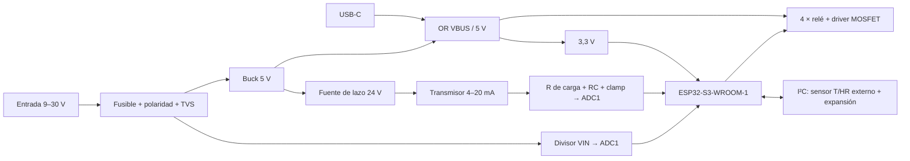

# Especificaciones de la PCB v2

**Estado:** borrador v0.1 (2026-11-03).

Decisiones de partida:

- Módulo ESP32-S3 soldado en la placa.
- Entrada de alimentación de 9–30 V DC.
- Solo cargas de baja tensión.
- Montaje SMT en JLCPCB y componentes THT soldados a mano.
- KiCad 10.

## 1. Objetivo

Rediseñar la placa del TFG conservando su función: 4 canales de riego, nivel de depósito, temperatura y humedad, e integración en Home Assistant mediante ESPHome. La v2 corrige los hallazgos de [01-analisis-v1.md](01-analisis-v1.md) y queda preparada para:

- funcionar en exterior;
- alimentarse con batería o panel solar;
- montarse en JLCPCB.

## 2. Resumen v1 → v2

| | v1 (TFG) | v2 (objetivo) |
|---|---|---|
| MCU | Wemos S2 Mini enchufable | ESP32-S3-WROOM-1 soldado, USB-C propio |
| Alimentación | 12 V por jack DC, sin protecciones | 9–30 V por borne, con protección de polaridad, TVS y fusible |
| Salidas | 4 relés, opto + BC817 | 4 relés, driver MOSFET de nivel lógico |
| Nivel | 4–20 mA alimentado a 12 V | 4–20 mA con fuente de lazo de 24 V y protecciones |
| Temperatura / humedad | DHT11 en placa | Sensor I²C externo (SHT4x) |
| Montaje | Todo a mano, 1210 / 0805 | SMT JLCPCB (≥ 0603) + THT a mano |
| Tamaño | 129 × 96,5 mm | ≤ 100 × 80 mm (objetivo) |
| Herramienta | KiCad 9 | KiCad 10 |

## 3. Arquitectura

## 4. Requisitos

Prioridad: **M** debe · **S** debería · **C** podría.

### 4.1 Alimentación (ALI)

| ID | P | Requisito |
|---|---|---|
| ALI-01 | M | Entrada de 9–30 V DC (nominal 12 V y 24 V: batería, panel solar con regulador o adaptador). |
| ALI-02 | M | Borne atornillado de 2 polos (5,08 mm) para la entrada. Un jack DC paralelo para banco sería opcional (C). |
| ALI-03 | M | Protección contra inversión de polaridad de bajas pérdidas (P-MOSFET o controlador de diodo ideal). |
| ALI-04 | M | Protección de entrada con fusible (PTC o fusible SMD) y TVS unidireccional (p. ej. SMBJ33A). |
| ALI-05 | M | Buck de 5 V ≥ 1,5 A con VIN máximo ≥ 60 V, para soportar con margen la tensión de *clamping* de la TVS. |
| ALI-06 | M | UVLO del buck ajustable por divisor; valor por defecto ≈ 8,5 V (v1: 11,7 V). |
| ALI-07 | M | Raíl de 3,3 V propio (LDO ≥ 800 mA desde 5 V, o buck) para el ESP32-S3 y los sensores. |
| ALI-08 | M | El USB-C alimenta la lógica para programar sin fuente externa. Se une al raíl de 5 V con diodo Schottky o ideal para no retroalimentar el PC ni la entrada. Con solo USB no se garantiza el accionamiento de los relés. |
| ALI-09 | S | Medida de VIN con divisor en un canal ADC1, para supervisar la batería desde Home Assistant. |
| ALI-10 | S | LED de alimentación. |
| ALI-11 | S | Test points en VIN, 5 V, 3,3 V y GND. |

### 4.2 Microcontrolador (MCU)

| ID | P | Requisito |
|---|---|---|
| MCU-01 | M | ESP32-S3-WROOM-1 (N8 o superior, antena PCB) soldado en la placa. |
| MCU-02 | M | Antena en el borde de la placa, con zona libre de cobre en todas las capas según la guía de diseño hardware de Espressif, y alejada de los relés y del buck. |
| MCU-03 | M | USB-C nativo (GPIO19/20, USB-Serial/JTAG) con protección ESD (p. ej. USBLC6-2SC6) y resistencias CC de 5,1 kΩ. |
| MCU-04 | M | Pulsadores BOOT (GPIO0) y RESET (EN) con red RC en EN. |
| MCU-05 | M | Asignación de pines: entradas analógicas solo en ADC1 (GPIO1–GPIO10); sin salidas en pines de arranque (GPIO0, 3, 45, 46); GPIO35–37 libres si el módulo lleva PSRAM octal; GPIO19/20 reservados al USB. |
| MCU-06 | S | Conector UART (TX/RX/GND/3V3) como alternativa de programación y depuración. |
| MCU-07 | S | LED de estado controlado por firmware. |

### 4.3 Salidas de relé (REL)

| ID | P | Requisito |
|---|---|---|
| REL-01 | M | 4 canales con relé SPDT de 5 V (SRD-05VDC-SL-C o equivalente) y borne de 3 polos de 5,08 mm (NO / COM / NC). |
| REL-02 | M | Solo baja tensión en contactos: ≤ 30 V DC / 24 V AC, nada de 230 V AC. Indicado en la serigrafía. |
| REL-03 | M | Driver con N-MOSFET de nivel lógico (o driver integrado) gobernado directamente por el GPIO, con diodo de rueda libre por bobina. Se elimina el optoacoplador. |
| REL-04 | M | Estado seguro: relés desactivados durante el arranque, el reset y el flasheo (pull-down en puerta, lógica activa a nivel alto). |
| REL-05 | M | Pistas de contacto dimensionadas para 5 A continuos con ΔT ≤ 10 °C (IPC-2152). |
| REL-06 | M | Mismo orden de pines en los 4 bornes, coherente entre esquema y PCB. |
| REL-07 | S | LED indicador por canal. |
| REL-08 | C | Puente opcional para alimentar los comunes desde VIN, con fusible, para válvulas de la misma tensión que la alimentación. |

### 4.4 Sensor de nivel 4–20 mA (NIV)

| ID | P | Requisito |
|---|---|---|
| NIV-01 | M | Fuente de lazo dedicada de 24 V (boost), para garantizar ≥ 12 V en el transmisor a 20 mA con cualquier VIN. |
| NIV-02 | M | Limitación de corriente del lazo (≈ 25–30 mA), para que un cortocircuito en el cable no dañe nada. |
| NIV-03 | M | Resistencia de carga de precisión (0,1 %, ≤ 25 ppm/°C) dimensionada para que 20 mA den ≤ 2,5 V, dentro de la zona lineal del ADC (p. ej. 120 Ω: 0,48–2,40 V). |
| NIV-04 | M | Filtro RC de impedancia moderada (p. ej. 10 kΩ + 2,2 µF, fc ≈ 7 Hz) en lugar de 270 kΩ, con clamp a 3,3 V / GND (BAT54S) antes del ADC. |
| NIV-05 | M | Entrada en un canal ADC1 y TVS en el borne del lazo. |
| NIV-06 | S | Detección de fallo en firmware: < 3,6 mA (lazo abierto) y > 21 mA (cortocircuito), según NAMUR NE43. |
| NIV-07 | C | ADC externo (ADS1115, I²C) si la precisión del ADC interno no basta. |
| NIV-08 | C | Segundo canal 4–20 mA para un segundo depósito. |

### 4.5 Temperatura y humedad (AMB)

| ID | P | Requisito |
|---|---|---|
| AMB-01 | M | Sensor I²C fuera de la caja (SHT4x o similar, en módulo con protector de radiación), conectado por cable. |
| AMB-02 | M | Conector de 4 polos (3V3, GND, SDA, SCL) con protección ESD y pull-ups seleccionables en placa. |
| AMB-03 | S | Cable de ≤ 2 m. Para más distancia, valorar un extensor I²C o un sensor RS-485 / Modbus. |
| AMB-04 | C | Compatibilidad con 1-Wire (DS18B20) en el mismo conector mediante puente. |

### 4.6 Entradas y expansión (EXP)

| ID | P | Requisito |
|---|---|---|
| EXP-01 | S | 1 entrada digital o de pulsos de 5–24 V, protegida, para caudalímetro o sensor de lluvia. |
| EXP-02 | S | Conector de expansión con I²C, 2 GPIO, 3V3 y GND. |
| EXP-03 | C | Pulsadores de accionamiento manual por canal (retoma la hoja `Panel_Control` del TFG). |

### 4.7 PCB y fabricación (FAB)

| ID | P | Requisito |
|---|---|---|
| FAB-01 | M | 2 capas, FR-4 de 1,6 mm, cobre de 1 oz (2 oz a evaluar según REL-05), acabado HASL sin plomo o ENIG. |
| FAB-02 | M | Reglas compatibles con JLCPCB estándar y con margen: pista y separación ≥ 0,2 mm, vía 0,3 / 0,6 mm, cobre a borde ≥ 0,5 mm. |
| FAB-03 | M | Clases de red `Default` (0,25 mm), `Power` (≥ 0,6 mm), `Relay_Load` (≥ 3 mm en 1 oz, separación ≥ 1 mm) y `Loop_4_20mA`. |
| FAB-04 | M | Plano de GND continuo en ambas caras con cosido de vías; sin cortes bajo el buck ni bajo las señales analógicas. |
| FAB-05 | M | SMD mínimo 0603 (sin 0402). Cada componente con campo `LCSC Part#` (preferencia: piezas *Basic* de JLCPCB) y exportación de BOM + CPL para JLCPCB. |
| FAB-06 | M | Componentes THT (relés, bornes) en la cara superior, soldados a mano o con montaje THT. |
| FAB-07 | M | Conectores de campo en un único borde, de cara a los prensaestopas. |
| FAB-08 | M | Dimensiones objetivo ≤ 100 × 80 mm (v1: 129 × 96,5 mm) con 4 taladros M3. Los anclajes DIN impresos en 3D se rediseñan. |
| FAB-09 | M | Serigrafía con la función de cada borne, polaridades, tensión máxima de contactos, versión y fecha. |
| FAB-10 | S | Barniz conformado recomendado para exterior, con los conectores enmascarados. |
| FAB-11 | M | Modelo 3D de todos los componentes, para comprobar el encaje en la caja. |

### 4.8 Proyecto KiCad (KIC)

| ID | P | Requisito |
|---|---|---|
| KIC-01 | M | KiCad 10. Librerías propias dentro del repositorio con rutas `${KIPRJMOD}`: sin rutas absolutas ni JSON de EasyEDA. |
| KIC-02 | M | Esquema jerárquico por bloques: alimentación, MCU, relés, sensores y conectores. |
| KIC-03 | M | Antes de fabricar: ERC sin errores, y DRC sin errores ni incidencias de paridad esquema↔PCB. |
| KIC-04 | S | Reglas en `.kicad_dru` (clases de red, zona de antena, separación de cargas). |
| KIC-05 | S | Salidas de fabricación generadas con `kicad-cli`, para que sean reproducibles. |

### 4.9 Firmware (FW)

| ID | P | Requisito |
|---|---|---|
| FW-01 | M | Configuración ESPHome en `firmware/`, con las credenciales en `secrets.yaml` (no versionado). |
| FW-02 | M | Pinout del YAML derivado del esquema v2 y comprobado durante la validación. |
| FW-03 | S | Supervisión de VIN, del estado del lazo 4–20 mA y de la temperatura interna. |
| FW-04 | S | Tiempo máximo de riego por canal en el firmware (protección ante fallos de comunicación). |

## 5. Condiciones ambientales

- Caja IP65 en exterior, temperatura de funcionamiento objetivo de −10 a +60 °C (caja al sol).
- Componentes con rango de al menos −20 a +85 °C.

## 6. Criterios de aceptación

Amplían las pruebas del pliego del TFG.

| Prueba | Criterio |
|---|---|
| Barrido de alimentación a 9, 12, 24 y 30 V | 5 V y 3,3 V dentro de ±3 %; sin reinicios al conmutar los 4 relés a la vez |
| Inversión de polaridad a 30 V | Sin daños |
| Lazo 4–20 mA simulado (4, 12 y 20 mA) | Error ≤ 1 % FS tras calibrar; cortocircuito del lazo sin daños |
| Relés | Los 4 canales conmutan; quedan desactivados durante el reset y el flasheo |
| Wi-Fi / Home Assistant | Conexión, OTA e integración correctas |
| Temperatura / humedad | Lectura coherente con una referencia |
| Térmica | 1 h con los 4 relés activos y 5 A en un canal: ΔT de las pistas ≤ 10 °C |

## 7. Decisiones abiertas

| ID | Decisión | Por defecto |
|---|---|---|
| D1 | Número de canales de relé | 4 |
| D2 | Alimentar los comunes de los relés desde VIN (REL-08) | Bornes libres |
| D3 | Segundo canal 4–20 mA (NIV-08) y entrada de pulsos (EXP-01) | Solo la entrada de pulsos |
| D4 | Pulsadores de forzado manual (EXP-03) | No |
| D5 | Modelo de caja IP65 y medidas internas | Pendiente de medir la caja actual |
| D6 | Cobre de 1 oz o 2 oz | 1 oz |
| D7 | ADC interno o ADS1115 para el 4–20 mA (NIV-07) | ADC interno |

## 8. Trazabilidad con los hallazgos v1

| Hallazgo | Requisitos |
|---|---|
| H1 Esquema y PCB desincronizados | REL-06, KIC-03 |
| H2 ADC2 con Wi-Fi | MCU-05, NIV-05 |
| H3 Lazo 4–20 mA | NIV-01 … NIV-05 |
| H4 Alimentación | ALI-01 … ALI-06 |
| H5 Optoacoplador | REL-03, REL-04 |
| H6 DHT11 | AMB-01, AMB-02 |
| H7 Wemos enchufable | MCU-01, MCU-03 |
| H8 Librerías absolutas | KIC-01 |
| H9 Hojas huérfanas | KIC-02, EXP-03 |
| H10 DRC | KIC-03 |
| H11 Tamaño y encapsulados | FAB-05, FAB-08 |
| H12 Firmware | FW-01, FW-02 |
