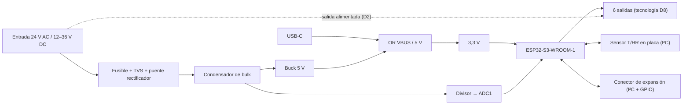

# Especificaciones de la PCB v2

**Estado:** borrador v0.2 (2026-11-04). Los cambios respecto a la v0.1 están en [DEC-0002](../gestion/decisiones/DEC-0002-objetivo-v2-revisado.md) y en el [historial](#10-historial).

Decisiones de partida:

- Módulo ESP32-S3 soldado en la placa.
- Alimentación desde el transformador de riego de 24 V AC; la entrada admite también DC.
- Instalación en interior (casa o caseta), en una caja ventilada colgada en la pared.
- Solo cargas de baja tensión.
- Montaje SMT en JLCPCB y componentes THT soldados a mano.
- KiCad 10.

## 1. Objetivo

Controlador de riego de **6 salidas**, con temperatura y humedad medidas en la placa e integración en Home Assistant mediante ESPHome. Se alimenta del mismo transformador de 24 V AC que las electroválvulas y se monta en interior, en una caja ventilada a la pared. Requisitos de diseño:

- Las salidas no deben quedar atadas a un único tipo de válvula. Su tecnología se decide con un estudio (D8).
- Se puede ampliar el número de canales con un módulo de expansión (D9).
- La v2 corrige los hallazgos de [01-analisis-v1.md](01-analisis-v1.md) y se monta en JLCPCB.
- No incluye sensor de nivel de depósito.

## 2. Resumen v1 → v2

| | v1 (TFG) | v2 (objetivo) |
|---|---|---|
| MCU | Wemos S2 Mini enchufable | ESP32-S3-WROOM-1 soldado, USB-C propio |
| Alimentación | 12 V DC por jack, sin protecciones | 24 V AC del transformador de riego (o 12–36 V DC) por borne, con fusible, TVS y puente rectificador |
| Salidas | 4 relés, opto + BC817 | 6 salidas; tecnología según el estudio de SPEC-0005 (D8) |
| Nivel | 4–20 mA alimentado a 12 V | Eliminado |
| Temperatura / humedad | DHT11 en placa | Sensor I²C en placa (SHT4x o similar), aislado térmicamente |
| Expansión | — | Conector para un módulo de más canales (D9) |
| Instalación | Caja estanca | Interior, caja ventilada a la pared |
| Montaje | Todo a mano, 1210 / 0805 | SMT JLCPCB (≥ 0603) + THT a mano |
| Tamaño | 129 × 96,5 mm | ≤ 100 mm de ancho; el alto depende de D8 (≈ 65–95 mm) |
| Herramienta | KiCad 9 | KiCad 10 |

## 3. Arquitectura

## 4. Requisitos

Prioridad: **M** debe · **S** debería · **C** podría.

### 4.1 Alimentación (ALI)

| ID | P | Requisito |
|---|---|---|
| ALI-01 | M | Entrada principal de 24 V AC nominales desde el transformador de riego: de 20 a 28 V AC eficaces, para cubrir la tolerancia de red y la tensión en vacío del transformador. También admite 12–36 V DC. |
| ALI-02 | M | Borne atornillado de 2 polos (5,08 mm) para la entrada. |
| ALI-03 | M | Puente rectificador de onda completa, que además hace la entrada insensible a la polaridad en DC. Condensador de bulk dimensionado para el rizado de 100 Hz a plena carga, de modo que el buck no caiga por debajo de su UVLO con 20 V AC. |
| ALI-04 | M | Protección de entrada: fusible (PTC o SMD) y TVS dimensionada para 28 V AC (pico ≈ 40 V): bidireccional en el lado de AC o unidireccional tras el puente. |
| ALI-05 | M | Buck de 5 V ≥ 1,5 A con VIN máximo ≥ 60 V, para soportar con margen la tensión de *clamping* de la TVS. |
| ALI-06 | M | UVLO del buck ajustable por divisor y con histéresis, por debajo del mínimo de entrada DC (12 V). |
| ALI-07 | M | Raíl de 3,3 V propio (LDO ≥ 800 mA desde 5 V, o buck) para el ESP32-S3 y los sensores. |
| ALI-08 | M | El USB-C alimenta la lógica para programar sin fuente externa. Se une al raíl de 5 V con diodo Schottky o ideal para no retroalimentar el PC ni la entrada. Con solo USB no se garantiza el accionamiento de las salidas. |
| ALI-09 | S | Medida de la tensión rectificada con divisor en un canal ADC1, para detectar desde Home Assistant el fallo o la caída del transformador. |
| ALI-10 | S | LED de alimentación. |
| ALI-11 | S | Test points en la tensión rectificada, 5 V, 3,3 V y GND. |

### 4.2 Microcontrolador (MCU)

| ID | P | Requisito |
|---|---|---|
| MCU-01 | M | ESP32-S3-WROOM-1 (N8 o superior, antena PCB) soldado en la placa. |
| MCU-02 | M | Antena en el borde de la placa, con zona libre de cobre en todas las capas según la guía de diseño hardware de Espressif, y alejada de las salidas y del buck. |
| MCU-03 | M | USB-C nativo (GPIO19/20, USB-Serial/JTAG) con protección ESD (p. ej. USBLC6-2SC6) y resistencias CC de 5,1 kΩ. |
| MCU-04 | M | Pulsadores BOOT (GPIO0) y RESET (EN) con red RC en EN. |
| MCU-05 | M | Asignación de pines: entradas analógicas solo en ADC1 (GPIO1–GPIO10); sin salidas en pines de arranque (GPIO0, 3, 45, 46); GPIO35–37 libres si el módulo lleva PSRAM octal; GPIO19/20 reservados al USB. |
| MCU-06 | S | Conector UART (TX/RX/GND/3V3) como alternativa de programación y depuración. |
| MCU-07 | S | LED de estado controlado por firmware. |

### 4.3 Salidas de riego (REL)

| ID | P | Requisito |
|---|---|---|
| REL-01 | M | 6 salidas. La tecnología de conmutación (relé electromecánico, SSR, triac o MOSFET) se elige con el estudio de SPEC-0005 (D8). |
| REL-02 | M | Solo baja tensión en las salidas: ≤ 30 V AC / 36 V DC, nada de 230 V AC. Indicado en la serigrafía. |
| REL-03 | M | Accionamiento directo desde GPIO (o desde un expansor), con la protección de la carga inductiva que exija la tecnología elegida (diodo, *snubber* o varistor). Sin optoacoplador, salvo que forme parte de la tecnología elegida (SSR u optotriac). |
| REL-04 | M | Estado seguro: salidas desactivadas durante el arranque, el reset y el flasheo (pull-down en la entrada de control, lógica activa a nivel alto). |
| REL-05 | M | Al menos 1 A continuo por canal (dos electroválvulas de 24 V AC en paralelo) y soporte de su corriente de arranque. Los valores definitivos, por canal y en total, se fijan al cerrar D8. Pistas dimensionadas con ΔT ≤ 10 °C (IPC-2152). |
| REL-06 | M | Mismo orden de pines en los 6 bornes, coherente entre esquema, PCB y serigrafía. |
| REL-07 | S | LED indicador por canal. |
| REL-08 | S | Opción de alimentar las válvulas desde la entrada de 24 V AC (salida alimentada, con fusible y borne común, como los programadores comerciales), además del contacto libre de potencial si la tecnología lo permite. La forma se decide con D2. |
| REL-09 | M | Salidas repartidas en dos bordes opuestos: canales 1–3 en el borde superior y canales 4–6 en el inferior. |

### 4.4 Temperatura y humedad (AMB)

| ID | P | Requisito |
|---|---|---|
| AMB-01 | M | Sensor de temperatura y humedad I²C en la placa (SHT4x o similar), para medir el aire del recinto. |
| AMB-02 | M | Aislamiento térmico del sensor: en un borde de la placa, lejos del buck, del LDO y de las salidas, con ranuras fresadas a su alrededor y sin planos de cobre debajo, y orientado hacia las rejillas de la caja. |
| AMB-03 | C | Sonda externa opcional por el conector I²C de expansión (EXP-02), para medir fuera del recinto. |

### 4.5 Entradas y expansión (EXP)

| ID | P | Requisito |
|---|---|---|
| EXP-01 | S | 1 entrada digital o de pulsos, protegida, para un caudalímetro o un sensor de lluvia: de 5 a 24 V o contacto seco. |
| EXP-02 | M | Conector de expansión con ESD: I²C, alimentación, al menos 2 GPIO (una de interrupción), 3V3 y GND. Los pines y tensiones salen del informe de viabilidad (EXP-04) antes de cerrar el esquema. |
| EXP-03 | C | Pulsadores de accionamiento manual por canal (retoma la hoja `Panel_Control` del TFG). |
| EXP-04 | S | Ampliación de canales con un módulo de expansión. Antes de fijar EXP-02 se hace un informe de viabilidad con arquitecturas, componentes y costes (SPEC-0006, D9). |

### 4.6 PCB y fabricación (FAB)

| ID | P | Requisito |
|---|---|---|
| FAB-01 | M | 2 capas, FR-4 de 1,6 mm, cobre de 1 oz (2 oz a evaluar según REL-05), acabado HASL sin plomo o ENIG. |
| FAB-02 | M | Reglas compatibles con JLCPCB estándar y con margen: pista y separación ≥ 0,2 mm, vía 0,3 / 0,6 mm, cobre a borde ≥ 0,5 mm. |
| FAB-03 | M | Clases de red `Default` (0,25 mm), `Power` (≥ 0,6 mm), `AC_In` (entrada y puente) y `Salidas` (ancho según REL-05, separación ≥ 1 mm). |
| FAB-04 | M | Plano de GND continuo en ambas caras con cosido de vías; sin cortes bajo el buck ni bajo las señales analógicas. |
| FAB-05 | M | SMD mínimo 0603 (sin 0402). Cada componente con campo `LCSC Part#` (preferencia: piezas *Basic* de JLCPCB) y exportación de BOM + CPL para JLCPCB. |
| FAB-06 | M | Componentes THT (relés si los hay, bornes) en la cara superior, soldados a mano o con montaje THT. |
| FAB-07 | M | Conectores de campo en los bordes superior e inferior: salidas según REL-09, y la entrada de alimentación y el conector de expansión en el borde inferior. El USB-C, accesible desde un lateral. |
| FAB-08 | M | Ancho ≤ 100 mm; el alto se fija al cerrar D8 (≈ 65–95 mm según la tecnología de salida). 4 taladros M3 para fijarla dentro de la caja. |
| FAB-09 | M | Serigrafía con la función de cada borne, polaridades, tensión máxima de las salidas, versión y fecha. |
| FAB-10 | C | Barniz conformado si el recinto es húmedo, con los conectores y el sensor de humedad enmascarados. |
| FAB-11 | M | Modelo 3D de todos los componentes, para comprobar el encaje en la caja. |

### 4.7 Proyecto KiCad (KIC)

| ID | P | Requisito |
|---|---|---|
| KIC-01 | M | KiCad 10. Librerías propias dentro del repositorio con rutas `${KIPRJMOD}`: sin rutas absolutas ni JSON de EasyEDA. |
| KIC-02 | M | Esquema jerárquico por bloques: alimentación, MCU, salidas, sensores y conectores. |
| KIC-03 | M | Antes de fabricar: ERC sin errores, y DRC sin errores ni incidencias de paridad esquema↔PCB. |
| KIC-04 | S | Reglas en `.kicad_dru` (clases de red, zona de antena, separación de las salidas). |
| KIC-05 | S | Salidas de fabricación generadas con `kicad-cli`, para que sean reproducibles. |

### 4.8 Firmware (FW)

| ID | P | Requisito |
|---|---|---|
| FW-01 | M | Configuración ESPHome en `firmware/`, con las credenciales en `secrets.yaml` (no versionado). |
| FW-02 | M | Pinout del YAML derivado del esquema v2 y comprobado durante la validación. |
| FW-03 | S | Supervisión de la alimentación (fallo del transformador), de la temperatura y la humedad del sensor en placa y de la temperatura interna del ESP32. |
| FW-04 | S | Tiempo máximo de riego por canal en el firmware (protección ante fallos de comunicación). |

## 5. Condiciones ambientales

- Interior (casa o caseta), en una caja ventilada colgada en la pared; no estanca.
- Temperatura de funcionamiento objetivo de −10 a +50 °C (caseta sin climatizar); humedad del 10 al 90 % HR sin condensación.
- Componentes con rango de al menos −20 a +85 °C.

## 6. Criterios de aceptación

Amplían las pruebas del pliego del TFG.

| Prueba | Criterio |
|---|---|
| Barrido de alimentación a 20, 24 y 28 V AC, y a 12, 24 y 36 V DC | 5 V y 3,3 V dentro de ±3 %; sin reinicios al conmutar las 6 salidas a la vez |
| DC con la polaridad invertida a 36 V | Funciona igual y sin daños |
| Fallo del transformador | Se detecta en Home Assistant (ALI-09) |
| Salidas | Los 6 canales conmutan una electroválvula de 24 V AC real y la corriente de REL-05; quedan desactivados durante el reset y el flasheo |
| Wi-Fi / Home Assistant | Conexión, OTA e integración correctas |
| Temperatura / humedad | Lectura coherente con una referencia (±0,5 °C, ±3 % HR) tras 1 h con las 6 salidas activas |
| Térmica | 1 h con las 6 salidas activas a la corriente de REL-05: ΔT de las pistas ≤ 10 °C |

## 7. Decisiones abiertas

| ID | Decisión | Estado |
|---|---|---|
| D1 | Número de canales | **Cerrada:** 6, ampliables (DEC-0002) |
| D2 | Salida alimentada desde 24 V AC, contacto libre o ambas (REL-08) | Pendiente de SPEC-0005 |
| D3 | Entrada de pulsos o de lluvia (EXP-01) | Por defecto, sí |
| D4 | Pulsadores de forzado manual (EXP-03) | Por defecto, no |
| D5 | Modelo de caja ventilada y medidas internas | Pendiente |
| D6 | Cobre de 1 oz o 2 oz | Por defecto, 1 oz; se revisa con D8 |
| D7 | ADC interno o ADS1115 para el 4–20 mA | **Sin objeto:** se elimina el sensor de nivel (DEC-0002) |
| D8 | Tecnología de las salidas: relé, SSR, triac o MOSFET (REL-01, REL-03, REL-05) | Pendiente de SPEC-0005 |
| D9 | Arquitectura del módulo de expansión (EXP-02, EXP-04) | Pendiente de SPEC-0006 |

## 8. Trazabilidad con los hallazgos v1

| Hallazgo | Requisitos |
|---|---|
| H1 Esquema y PCB desincronizados | REL-06, KIC-03 |
| H2 ADC2 con Wi-Fi | MCU-05, ALI-09 |
| H3 Lazo 4–20 mA | Sin objeto: se elimina el sensor de nivel (DEC-0002) |
| H4 Alimentación | ALI-01 … ALI-06 |
| H5 Optoacoplador | REL-03, REL-04 |
| H6 DHT11 | AMB-01, AMB-02 |
| H7 Wemos enchufable | MCU-01, MCU-03 |
| H8 Librerías absolutas | KIC-01 |
| H9 Hojas huérfanas | KIC-02, EXP-03 |
| H10 DRC | KIC-03 |
| H11 Tamaño y encapsulados | FAB-05, FAB-08 |
| H12 Firmware | FW-01, FW-02 |

## 9. Requisitos retirados

Sus IDs no se reutilizan.

| ID | Retirado en | Decisión | Requisito en la versión anterior |
|---|---|---|---|
| NIV-01 | v0.2 | DEC-0002 | Fuente de lazo dedicada de 24 V (boost) |
| NIV-02 | v0.2 | DEC-0002 | Limitación de corriente del lazo |
| NIV-03 | v0.2 | DEC-0002 | Resistencia de carga de precisión |
| NIV-04 | v0.2 | DEC-0002 | Filtro RC y clamp antes del ADC |
| NIV-05 | v0.2 | DEC-0002 | Entrada en ADC1 y TVS en el borne del lazo |
| NIV-06 | v0.2 | DEC-0002 | Detección de fallo del lazo según NAMUR NE43 |
| NIV-07 | v0.2 | DEC-0002 | ADC externo ADS1115 |
| NIV-08 | v0.2 | DEC-0002 | Segundo canal 4–20 mA |
| AMB-04 | v0.2 | DEC-0002 | Compatibilidad 1-Wire (DS18B20) en el conector del sensor externo |

En la v0.2 se redefinen, sin cambiar de ID (ninguna spec ni commit los citaba aún):

- AMB-01 … AMB-03: de sonda externa a sensor en placa.
- ALI-01 … ALI-04: de 9–30 V DC a 24 V AC rectificada.
- REL-01, REL-03, REL-05 y REL-08: de 4 relés a 6 salidas con tecnología por decidir.

## 10. Historial

| Versión | Fecha | Cambios | Spec · decisión |
|---|---|---|---|
| v0.1 | 2026-11-03 | Primera versión, a partir del análisis de la v1 | SPEC-0000 |
| v0.2 | 2026-11-04 | Interior con caja ventilada; 24 V AC; 6 salidas (3 + 3); T/HR en placa; sin sensor de nivel; módulo de expansión; D8 y D9 | SPEC-0004 · DEC-0002 |
