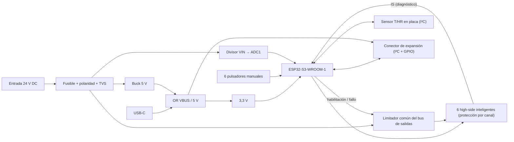

# Especificaciones de la PCB v2

**Estado:** borrador v0.6 (2026-11-13). Los cambios respecto a la v0.1 están en [DEC-0002](../gestion/decisiones/DEC-0002-objetivo-v2-revisado.md), [DEC-0003](../gestion/decisiones/DEC-0003-salidas-high-side-y-limitador.md), [DEC-0004](../gestion/decisiones/DEC-0004-fuente-led-y-carga-maxima.md), [DEC-0008](../gestion/decisiones/DEC-0008-led-rojo-rueda-libre-y-separacion-salidas.md), [DEC-0011](../gestion/decisiones/DEC-0011-sin-pulsos-pulsadores-conector-y-valvulas.md) y en el [historial](#10-historial).

Decisiones de partida:

- Módulo ESP32-S3 soldado en la placa.
- Alimentación única desde una fuente de 24 V DC y 5 A de tipo LED (DEC-0004).
- Instalación en interior (casa o caseta), en una caja ventilada colgada en la pared.
- Solo cargas de baja tensión.
- Montaje SMT en JLCPCB y componentes THT soldados a mano.
- KiCad 10.

## 1. Objetivo

Controlador de riego de **6 salidas**, con temperatura y humedad medidas en la placa e integración en Home Assistant mediante ESPHome. Se alimenta de una fuente de 24 V DC y se monta en interior, en una caja ventilada a la pared.

- Las salidas alimentan en continua, a 24 V DC, las electroválvulas, con un *high-side* inteligente por canal, con protección y diagnóstico (D8, DEC-0003), detrás de un limitador común del bus de salidas.
- Las válvulas instaladas son Bermad S-390-3-D, con bobina de 24 V AC (0,2 A y 3,5 W en AC según su etiqueta). Hoy funcionan las seis a la vez con la fuente de 24 V DC; falta medir su corriente en continua (DEC-0011, REL-03).
- 6 pulsadores manuales en la placa, uno por salida, que lee el firmware (EXP-03).
- El número de canales se puede ampliar con un módulo de expansión (D9).
- La v2 corrige los hallazgos de [01-analisis-v1.md](01-analisis-v1.md) y se monta en JLCPCB.
- No incluye sensor de nivel de depósito (DEC-0002) ni entrada de pulsos o de lluvia (DEC-0011).

## 2. Resumen v1 → v2

| | v1 (TFG) | v2 (objetivo) |
|---|---|---|
| MCU | Wemos S2 Mini enchufable | ESP32-S3-WROOM-1 soldado, USB-C propio |
| Alimentación | 12 V DC por jack, sin protecciones | 24 V DC de una fuente LED de 5 A, por borne, con protección de polaridad, fusible y TVS |
| Salidas | 4 relés, opto + BC817 | 6 salidas alimentadas de 24 V DC con *high-side* inteligente (BTT6050-1ERA) y limitador común |
| Nivel | 4–20 mA alimentado a 12 V | Eliminado |
| Temperatura / humedad | DHT11 en placa | Sensor I²C en placa (SHT4x o similar), aislado térmicamente, que mide el aire de la caseta |
| Accionamiento manual | Hoja `Panel_Control` sin conectar (H9) | 6 pulsadores en la placa, uno por salida, leídos por el firmware |
| Expansión | — | Conector para un módulo de más canales (D9) |
| Instalación | Caja estanca | Interior, caja ventilada a la pared |
| Montaje | Todo a mano, 1210 / 0805 | SMT JLCPCB (≥ 0603) + THT a mano |
| Tamaño | 129 × 96,5 mm | ≈ 100 × 70 mm |
| Herramienta | KiCad 9 | KiCad 10 |

## 3. Arquitectura

## 4. Requisitos

Prioridad: **M** debe · **S** debería · **C** podría.

### 4.1 Alimentación (ALI)

| ID | P | Requisito |
|---|---|---|
| ALI-01 | M | Entrada única de 24 V DC nominales desde una fuente de alimentación. Rango de funcionamiento de 18 a 30 V DC, para cubrir la caída en el cable y la tolerancia. La fuente se deja en su ajuste de fábrica de 24 V (± 2 %): el total de las salidas (ALI-12) y la banda del limitador (ALI-13) valen con esa tensión (DEC-0004). |
| ALI-02 | M | Borne atornillado de 2 polos (5,08 mm) para la entrada. |
| ALI-03 | M | Protección contra inversión de polaridad de bajas pérdidas (P-MOSFET o controlador de diodo ideal), dimensionada para la corriente de entrada de ALI-12. |
| ALI-04 | M | Protección de entrada: fusible (PTC o SMD) y TVS. La TVS es unidireccional y va **después** de la protección de polaridad, o bidireccional (p. ej. SMBJ33CA) si va en el borne. Tensión de trabajo (VRWM) ≥ 33 V y tensión de ruptura mínima por encima de la OVP máxima de la fuente (33,6 V supuesta, DEC-0004): SMBJ33A (VBR ≥ 36,7 V). Su tensión de *clamping* (Vc) no supera, en ninguna pieza conectada al nodo, el máximo absoluto o, si el fabricante la especifica, la tensión de *load dump* (p. ej. V_S(LD) = 65 V del BTT6050). |
| ALI-05 | M | Buck de 5 V ≥ 1,5 A. Su VIN máxima, y la tensión nominal de los condensadores y de cada pieza del nodo de entrada, son ≥ la tensión de *clamping* máxima (Vc) de la TVS elegida con un 10 % de margen (orientativo: ≥ 60 V con SMBJ33A, Vc = 53,3 V). Se admite un valor menor solo si `docs/diseno/` justifica una Vc más baja con la corriente de pulso limitada. |
| ALI-06 | M | UVLO del buck ajustable por divisor y con histéresis, referido a la tensión tras las protecciones de entrada: umbral de subida por debajo de 18 V menos la caída de las protecciones, con margen (≈ 15 V), y por encima de la VIN mínima del buck para dar 5 V a 1,5 A. Con la tolerancia del divisor y de la referencia, la placa arranca en frío desde 17 V y, una vez en marcha, sigue funcionando hasta 15,5 V (UVLO de bajada más la caída de las protecciones ≤ 15,5 V; ALI-09). |
| ALI-07 | M | Raíl de 3,3 V propio (LDO ≥ 800 mA desde 5 V, o buck) para el ESP32-S3 y los sensores. |
| ALI-08 | M | El USB-C alimenta la lógica para programar sin fuente externa. Se une al raíl de 5 V con diodo Schottky o ideal para no retroalimentar el PC ni la entrada. Con solo USB no se garantiza el accionamiento de las salidas. |
| ALI-09 | S | Medida de VIN con divisor en un canal ADC1, para avisar en Home Assistant de subtensión (por debajo de 17 V, entre el UVLO y el mínimo de ALI-01; la placa arranca en frío desde 17 V) o sobretensión (por encima de 31 V, entre el máximo de ALI-01 y la VRWM de la TVS). Precisión de la medida ≤ ± 3 % en todo el rango. El corte total de la fuente se ve como la placa «no disponible»; no se añade reserva de energía (decisión del usuario). |
| ALI-10 | S | LED de alimentación. |
| ALI-11 | S | Test points en VIN, 5 V, 3,3 V y GND. |
| ALI-12 | M | Presupuesto de potencia: fuente LED de 24 V DC y 5 A (120 W) en su ajuste de fábrica (ALI-01), con protección de sobrecarga desde el 105 % de la potencia (≥ 5,14 A a 24,5 V, DEC-0004). Las 6 salidas pueden estar activas a la vez; su corriente total la limita el limitador común (ALI-13), por encima de la carga instalada máxima: 3,5 A (12 válvulas de 0,25 A a 24 V y 20 °C; a 24,5 V y con la bobina a −10 °C, 3,47 A). La lógica, incluido el 5 V de la expansión, consume ≤ 4,8 W en la entrada (≤ 0,2 A a 24 V). Fusible, protección de polaridad, bus de las salidas y pistas de entrada (`Power_In`) dimensionados para la corriente máxima de entrada (5,1 A: límite superior del limitador más la lógica), continua y a 50 °C, sin actuar. |
| ALI-13 | M | Limitador común del bus de las salidas (eFuse o controlador *hot-swap*), entre las protecciones de entrada y los *high-side*; el buck se alimenta antes del limitador. Tensión nominal según ALI-05 (≥ 60 V). Umbral de corriente dentro de la banda 3,5–4,9 A con su tolerancia incluida (≈ 4,2 A ± 16 %): no actúa con la carga instalada máxima de ALI-12 (3,5 A) y, sumado a la lógica (≤ 0,2 A), queda por debajo de los 5,14 A a los que puede actuar la fuente (DEC-0004). Corte por fallo (temporizador o térmico) lo bastante rápido para que la entrada del buck no baje del UVLO (ALI-06): la lógica no depende de una retención (*hold-up*). Habilitación desde un GPIO con *pull-down* (corte general: el firmware habilita el bus mientras algún canal riega y durante la comprobación de carga abierta de REL-10) e indicación de fallo a un GPIO. Deseable: medida de la corriente total en un ADC1. |

### 4.2 Microcontrolador (MCU)

| ID | P | Requisito |
|---|---|---|
| MCU-01 | M | ESP32-S3-WROOM-1 (N8 o superior, antena PCB) soldado en la placa. |
| MCU-02 | M | Antena en el borde de la placa, con zona libre de cobre en todas las capas según la guía de diseño hardware de Espressif, y alejada de las salidas y del buck. |
| MCU-03 | M | USB-C nativo (GPIO19/20, USB-Serial/JTAG) con protección ESD (p. ej. USBLC6-2SC6) y resistencias CC de 5,1 kΩ. |
| MCU-04 | M | Pulsadores BOOT (GPIO0) y RESET (EN) con red RC en EN. |
| MCU-05 | M | Asignación de pines: entradas analógicas solo en ADC1 (GPIO1–GPIO10); sin salidas en pines de arranque (GPIO0, 3, 45, 46); GPIO35–37 libres si el módulo lleva PSRAM octal; GPIO19/20 reservados al USB. |
| MCU-06 | S | Conector UART (TX/RX/GND/3V3) como alternativa de programación y depuración. |
| MCU-07 | S | LED de estado controlado por firmware. |

### 4.3 Salidas de riego (REL)

| ID | P | Requisito |
|---|---|---|
| REL-01 | M | Al menos 6 salidas en la placa (6 en esta versión), ampliables con el módulo de expansión (EXP-04). Cada salida es un *high-side* inteligente de 24 V (D8, DEC-0003). |
| REL-02 | M | Solo baja tensión en las salidas: las salidas dan la tensión de entrada (≤ 30 V DC, ALI-01) y no admiten fuentes externas ni AC. Nada de 230 V AC. Indicado en la serigrafía. |
| REL-03 | M | Cada salida usa un *high-side* inteligente de 24 V (BTT6050-1ERA, o BTT6030-2ERA como segunda fuente; DEC-0003), accionado directamente desde GPIO o desde un expansor: entrada activa alta compatible con 3,3 V. Sin optoacoplador ni relé (causa de H5). Carga inductiva con el *clamp* integrado: la energía de desmagnetización con el máximo de válvulas por canal (2), calculada con la ecuación del fabricante, queda por debajo de la curva E_AS(I_L) del datasheet a esa corriente. Las válvulas instaladas son de 24 V AC (Bermad S-390-3-D) alimentadas en continua: su corriente a 24 V DC y su inductancia se miden o se toman del fabricante antes de cerrar el esquema (etiqueta `v2.0-sch`), y con ellas se revisan la energía de desmagnetización, la corriente por canal y la carga instalada (REL-05, ALI-12; DEC-0011). |
| REL-04 | M | Estado seguro: salidas y limitador común (ALI-13) desactivados durante el arranque, el reset y el flasheo (pull-down en la entrada de control, lógica activa a nivel alto). |
| REL-05 | M | Carga máxima por canal: 1 A continuo, como parámetro de la placa indicado en la serigrafía (carga real de 0,2–0,56 A con una o dos electroválvulas), con soporte de su corriente de arranque. Las 6 salidas pueden estar activas a la vez, con el total de ALI-12 impuesto por el limitador común (ALI-13). Sin protección de sobrecarga por canal (DEC-0004): la pista y el borne de cada salida soportan sin daño la corriente máxima del limitador (4,9 A) con ΔT ≤ 40 °C (≈ 1,2 mm con 1 oz, IPC-2221), y con la carga máxima, ΔT ≤ 10 °C (IPC-2152). |
| REL-06 | M | Mismo orden de pines en los 6 bornes, coherente entre esquema, PCB y serigrafía. |
| REL-07 | S | LED indicador por canal. |
| REL-08 | M | Salidas alimentadas desde la entrada de 24 V DC a través del limitador común (ALI-13), sin contacto libre de potencial (D2, DEC-0003). Protección de cada canal: la limitación de corriente y el apagado térmico del *high-side*, más el limitador común; sin fusible ni protección de sobrecarga por canal (REL-05, DEC-0004). Ante un corto en el cable de un canal, la lógica no se reinicia; el bus de las salidas puede cortarse un momento, y el firmware identifica el canal en fallo, lo deja apagado, avisa en Home Assistant y rearma los demás en ≤ 5 s. Si el *high-side* se enclava por temperatura (sobrecarga sin corto), el canal queda apagado hasta que su entrada vuelve a conmutar: el firmware lo detecta (IS, DEN), avisa y no lo reintenta en el mismo riego. |
| REL-09 | M | Salidas repartidas en dos bordes opuestos: canales 1–3 en el borde superior y canales 4–6 en el inferior. |
| REL-10 | S | Diagnóstico por canal en Home Assistant: corriente, carga abierta (válvula desconectada o cable cortado) y corto. La salida de medida (IS) llega a un ADC1 a través de una resistencia en serie, con la tensión acotada ≤ 3,1 V también en fallo; la carga abierta se comprueba con el canal apagado y el bus de las salidas habilitado (ALI-13), con un *pull-up* que deja por la válvula una fuga ≤ 1 mA. El firmware avisa, sin cortar, si un canal supera la carga máxima de REL-05. |

### 4.4 Temperatura y humedad (AMB)

| ID | P | Requisito |
|---|---|---|
| AMB-01 | M | Sensor de temperatura y humedad I²C en la placa (SHT4x o similar), para medir el aire de la caseta o la habitación donde está la caja, no el interior de la caja. |
| AMB-02 | M | Aislamiento térmico del sensor: en un borde de la placa, lejos del buck, del LDO, del módulo ESP32-S3 y de las salidas, con ranuras fresadas a su alrededor y sin planos de cobre debajo, y orientado hacia las rejillas de la caja. El firmware admite una corrección (*offset*) calibrada contra una referencia, que tiene que valer en reposo y con las salidas activas; si una corrección fija no basta, depende del número de salidas activas o de la temperatura interna del ESP32 (FW-03). |
| AMB-03 | C | Sonda externa opcional por el conector I²C de expansión (EXP-02), para medir fuera del recinto. |

### 4.5 Entradas y expansión (EXP)

| ID | P | Requisito |
|---|---|---|
| EXP-02 | M | Conector de expansión con ESD: I²C, alimentación, al menos 2 GPIO (una de interrupción), 3V3 y GND. SPEC-0006 fija sus pines, tensiones, tipo y ESD junto con el informe de viabilidad (EXP-04), antes de cerrar el esquema (DEC-0011). |
| EXP-03 | S | 6 pulsadores de accionamiento manual en la placa, uno por salida, en fila en el centro de la placa (solo se alcanzan con la caja abierta). Los lee el firmware con antirrebote; no actúan directamente sobre la salida, y el accionamiento manual mantiene las protecciones del firmware (REL-08, FW-04). Retoma la hoja `Panel_Control` del TFG (DEC-0011). |
| EXP-04 | M | Ampliación de canales con un módulo de expansión. SPEC-0006 hace un informe de viabilidad con arquitecturas, componentes y costes y, con él, fija el conector EXP-02; el usuario decide D9 con ese informe (DEC-0011). |

### 4.6 PCB y fabricación (FAB)

| ID | P | Requisito |
|---|---|---|
| FAB-01 | M | 2 capas, FR-4 de 1,6 mm, cobre de 1 oz (2 oz a evaluar en el layout con `Power_In` a 5 A y las salidas según REL-05; D6), acabado HASL sin plomo o ENIG. |
| FAB-02 | M | Reglas compatibles con JLCPCB estándar y con margen: pista y separación ≥ 0,2 mm, vía 0,3 / 0,6 mm, cobre a borde ≥ 0,5 mm. |
| FAB-03 | M | Clases de red `Default` (0,25 mm), `Power` (≥ 0,6 mm), `Power_In` (entrada, protecciones, limitador común y bus de las salidas hasta cada *high-side*, 5,1 A según ALI-12) y `Salidas` (de cada *high-side* a su borne, ancho según REL-05, separación ≥ 1 mm; ≥ 0,6 mm cuando uno de los objetos es un pad de un *high-side*, de su R_OL o de su C_OUT, o está dentro de su patio, DEC-0008). Los retornos GND de los bornes de salida llegan al plano por un camino dimensionado para la corriente máxima del limitador (4,9 A, ALI-13). |
| FAB-04 | M | Plano de GND continuo en ambas caras con cosido de vías; sin cortes bajo el buck ni bajo las señales analógicas. |
| FAB-05 | M | SMD mínimo 0603 (sin 0402). Cada componente con campo `LCSC Part#` (preferencia: piezas *Basic* de JLCPCB) y exportación de BOM + CPL para JLCPCB. |
| FAB-06 | M | Componentes THT (bornes) en la cara superior, soldados a mano o con montaje THT. |
| FAB-07 | M | Conectores de campo en los bordes superior e inferior: salidas según REL-09, con 2 polos por canal (OUT_n y GND), es decir, 6 polos por borde (30,5 mm a 5,08 mm); en el inferior, también la entrada de alimentación y el conector de expansión. Antes del layout, `docs/diseno/` justifica la longitud de cada borde con los taladros M3. Los laterales quedan para la antena (MCU-02), el USB-C (accesible desde fuera) y el sensor de temperatura y humedad (AMB-02). Los pulsadores de EXP-03 van en el centro de la placa, no en los bordes. |
| FAB-08 | M | Ancho ≤ 100 mm y alto ≈ 70 mm (± 5 mm, se confirma en el layout). 4 taladros M3 para fijarla dentro de la caja. |
| FAB-09 | M | Serigrafía con la función de cada borne, polaridades, tensión máxima y carga máxima por canal de las salidas (REL-05), versión y fecha. |
| FAB-10 | C | Barniz conformado si el recinto es húmedo, con los conectores y el sensor de humedad enmascarados. |
| FAB-11 | M | Modelo 3D de todos los componentes, para comprobar el encaje en la caja. |

### 4.7 Proyecto KiCad (KIC)

| ID | P | Requisito |
|---|---|---|
| KIC-01 | M | KiCad 10. Librerías propias dentro del repositorio con rutas `${KIPRJMOD}`: sin rutas absolutas ni JSON de EasyEDA. |
| KIC-02 | M | Esquema jerárquico por bloques: alimentación, MCU, salidas, sensores y conectores. |
| KIC-03 | M | Antes de fabricar: ERC sin errores, y DRC sin errores ni incidencias de paridad esquema↔PCB. |
| KIC-04 | S | Reglas en `.kicad_dru` (clases de red, zona de antena, separación de las salidas). |
| KIC-05 | S | Salidas de fabricación generadas con `kicad-cli`, para que sean reproducibles. |

### 4.8 Firmware (FW)

| ID | P | Requisito |
|---|---|---|
| FW-01 | M | Configuración ESPHome en `firmware/`, con las credenciales en `secrets.yaml` (no versionado). |
| FW-02 | M | Pinout del YAML derivado del esquema v2 y comprobado durante la validación. |
| FW-03 | S | Supervisión de la alimentación (subtensión y sobretensión, ALI-09), de la temperatura y la humedad del sensor en placa (con la corrección de AMB-02) y de la temperatura interna del ESP32. |
| FW-04 | S | Tiempo máximo de riego por canal en el firmware (protección ante fallos de comunicación). |

## 5. Condiciones ambientales

- Interior (casa o caseta), en una caja ventilada colgada en la pared; no estanca.
- Temperatura de funcionamiento objetivo de −10 a +50 °C (caseta sin climatizar); humedad del 10 al 90 % HR sin condensación.
- Componentes con rango de al menos −20 a +85 °C.

## 6. Criterios de aceptación

Amplían las pruebas del pliego del TFG.

| Prueba | Criterio |
|---|---|
| Barrido de alimentación a 18, 24 y 30 V DC | 5 V y 3,3 V dentro de ±3 %; sin reinicios al conmutar las 6 salidas a la vez ni al habilitar el limitador común |
| Polaridad invertida a 30 V DC | Sin daños ni actuación del fusible |
| Entrada a 16 V (bajando desde 24 V), 18 V, 29,5 V y 32,5 V DC | Aviso de subtensión a 16 V y de sobretensión a 32,5 V en Home Assistant; ningún aviso a 18 V ni a 29,5 V (ALI-09) |
| Arranque en frío a 17 V | La placa arranca con la entrada a 17 V (ALI-06) |
| Consumo de la lógica | Potencia de entrada ≤ 4,8 W (≤ 0,2 A a 24 V) con las salidas apagadas, el Wi-Fi transmitiendo y el 5 V de la expansión a su carga máxima (ALI-12) |
| Corte total de la fuente | La placa aparece como no disponible en Home Assistant; al volver la tensión, arranca con las salidas desactivadas (REL-04) |
| Salidas | Los 6 canales conmutan una de las electroválvulas instaladas (24 V AC, alimentada a 24 V DC; DEC-0011) y la corriente de REL-05; ellos y el limitador común quedan desactivados durante el reset y el flasheo (REL-04) |
| Pulsadores manuales | Cada pulsador enciende y apaga solo su canal a través del firmware, con un cambio por pulsación, sin rebotes (EXP-03) |
| Wi-Fi / Home Assistant | Conexión, OTA e integración correctas |
| Temperatura / humedad | Tras calibrar la corrección de AMB-02, lectura coherente (±0,5 °C, ±3 % HR) con una referencia situada en la caseta, fuera de la caja, en reposo y tras 1 h con las 6 salidas activas, aplicando en cada estado la corrección de AMB-02 que le corresponde (fija, o según las salidas activas) |
| Cortocircuito en una salida | Corto franco en el borne y con un cable largo (≥ 10 m), con la fuente de 5 A: actúa el limitador común; la lógica no se reinicia; el firmware deja apagado el canal en fallo, avisa en Home Assistant y los demás canales vuelven a funcionar en ≤ 5 s (REL-08) |
| Sobrecarga del conjunto de salidas, con la fuente LED de 5 A a 24 V | Con 3,4 A en las salidas no actúa el limitador; con 5,5 A (por encima de la banda, sin corto) actúa antes que la fuente y la lógica no se reinicia (ALI-12, ALI-13) |
| Sobrecarga de un canal, a 24 V | Un solo canal con 3,4 A durante 1 h (por debajo de la banda del limitador): sin daños, ΔT de su pista ≤ 20 °C (la pista de REL-05 da ≈ 18 °C) y aviso de sobrecarga en Home Assistant; si el *high-side* se enclava por temperatura, se comporta según REL-08 (REL-05, REL-10) |
| Diagnóstico | Una válvula desconectada y un canal en corto aparecen en Home Assistant (REL-10) |
| Térmica | 1 h con las 6 salidas activas y la carga instalada máxima de ALI-12 (3,5 A) repartida con al menos dos canales a la carga máxima de REL-05 (p. ej. 1 + 1 + 0,375 × 4 A): ΔT de las pistas ≤ 10 °C |

## 7. Decisiones abiertas

| ID | Decisión | Estado |
|---|---|---|
| D1 | Número de canales | **Cerrada:** 6, ampliables (DEC-0002) |
| D2 | Salida alimentada desde 24 V DC, contacto libre o ambas (REL-08) | **Cerrada:** solo salida alimentada (DEC-0003) |
| D3 | Entrada de pulsos o de lluvia (EXP-01) | **Cerrada:** no hay entrada de pulsos ni de lluvia; EXP-01 retirado (DEC-0011) |
| D4 | Pulsadores de forzado manual (EXP-03) | **Cerrada:** 6 en la placa, uno por salida, leídos por el firmware (DEC-0011) |
| D5 | Modelo de caja ventilada y medidas internas | Pendiente |
| D6 | Cobre de 1 oz o 2 oz | Por defecto, 1 oz; se revisa en el layout con `Power_In` a 5 A y las salidas a 4,9 A (REL-05) |
| D7 | ADC interno o ADS1115 para el 4–20 mA | **Sin objeto:** se elimina el sensor de nivel (DEC-0002) |
| D8 | Tecnología de las salidas (REL-01, REL-03, REL-05) | **Cerrada:** *high-side* inteligente BTT6050-1ERA, con limitador común (DEC-0003) |
| D9 | Arquitectura del módulo de expansión (EXP-02, EXP-04) | Pendiente: la decide el usuario con el informe de SPEC-0006, que fija también el conector EXP-02 (DEC-0011) |

## 8. Trazabilidad con los hallazgos v1

| Hallazgo | Requisitos |
|---|---|
| H1 Esquema y PCB desincronizados | REL-06, KIC-03 |
| H2 ADC2 con Wi-Fi | MCU-05, ALI-09 |
| H3 Lazo 4–20 mA | Sin objeto: se elimina el sensor de nivel (DEC-0002) |
| H4 Alimentación | ALI-01 … ALI-06, ALI-12 |
| H5 Optoacoplador | REL-03, REL-04 |
| H6 DHT11 | AMB-01, AMB-02, AMB-03 (se mide la caseta: DEC-0002, decisión 3) |
| H7 Wemos enchufable | MCU-01, MCU-03, FAB-07 |
| H8 Librerías absolutas | KIC-01 |
| H9 Hojas huérfanas | KIC-02, EXP-03 |
| H10 DRC | KIC-03 |
| H11 Tamaño y encapsulados | FAB-05, FAB-08 |
| H12 Firmware | FW-01, FW-02 |

## 9. Requisitos retirados

Sus IDs no se reutilizan.

| ID | Retirado en | Decisión | Motivo | Requisito en la versión anterior |
|---|---|---|---|---|
| NIV-01 | v0.2 | DEC-0002 | Se elimina el sensor de nivel (DEC-0002, decisión 4) | Fuente de lazo dedicada de 24 V (boost) |
| NIV-02 | v0.2 | DEC-0002 | Se elimina el sensor de nivel (DEC-0002, decisión 4) | Limitación de corriente del lazo |
| NIV-03 | v0.2 | DEC-0002 | Se elimina el sensor de nivel (DEC-0002, decisión 4) | Resistencia de carga de precisión |
| NIV-04 | v0.2 | DEC-0002 | Se elimina el sensor de nivel (DEC-0002, decisión 4) | Filtro RC y clamp antes del ADC |
| NIV-05 | v0.2 | DEC-0002 | Se elimina el sensor de nivel (DEC-0002, decisión 4) | Entrada en ADC1 y TVS en el borne del lazo |
| NIV-06 | v0.2 | DEC-0002 | Se elimina el sensor de nivel (DEC-0002, decisión 4) | Detección de fallo del lazo según NAMUR NE43 |
| NIV-07 | v0.2 | DEC-0002 | Se elimina el sensor de nivel (DEC-0002, decisión 4) | ADC externo ADS1115 |
| NIV-08 | v0.2 | DEC-0002 | Se elimina el sensor de nivel (DEC-0002, decisión 4) | Segundo canal 4–20 mA |
| EXP-01 | v0.6 | DEC-0011 | Sin caudalímetro ni sensor de lluvia (DEC-0011, decisión 1); GPIO37 (`PULSE_IN`) queda libre | 1 entrada digital o de pulsos (S), protegida, para un caudalímetro o un sensor de lluvia: de 5 a 24 V o contacto seco |
| AMB-04 | v0.2 | DEC-0002 | Ya no hay conector de sonda externa propio: el sensor va en placa (decisión 3) y la sonda opcional usa el I²C de expansión (AMB-03) | Compatibilidad 1-Wire (DS18B20) en el conector del sensor externo |

En la v0.2 se redefinen sin cambiar de ID. Cuando se redefinieron, solo SPEC-0005 citaba alguno (REL-01, REL-03 y REL-05), y ya con el sentido nuevo.

- ALI-01 … ALI-06 y ALI-09: de 9–30 V DC con batería o panel solar a una fuente de 24 V DC (18–30 V).
- REL-01 … REL-05 y REL-08: de 4 relés a 6 salidas con tecnología por decidir.
- AMB-01 … AMB-03: de sonda externa a sensor en placa.
- EXP-02, FAB-03, FAB-07, FAB-08, FAB-10 y FW-03.
- Ajustes menores de redacción: EXP-01 (añade «o contacto seco»), REL-06 (añade la serigrafía) y el paso de «relés» a «salidas».

Cambios de prioridad: REL-08 C → S, EXP-02 S → M, AMB-03 S → C y FAB-10 S → C. Nuevos: REL-09 (M), EXP-04 (M) y ALI-12 (M).

En la v0.3 (DEC-0003):

- REL-01, REL-03 y REL-05: de «tecnología por decidir» al *high-side* inteligente (D8).
- REL-02 y REL-08: sin contacto libre de potencial (D2); REL-08 pasa de S a M y admite que el bus de las salidas se corte un momento ante un corto.
- REL-04: incluye el limitador común.
- ALI-04 (orden y tensión de la TVS), ALI-09 (puntos de aviso), ALI-12 (mecanismo del límite de 4 A), AMB-02 (corrección en reposo y con carga), FAB-03, FAB-06, FAB-07 y FAB-08.
- Nuevos: ALI-13 (M) y REL-10 (S).

En la v0.4 (DEC-0004):

- ALI-01, ALI-12 y ALI-13: fuente LED de 5 A supuesta, en su ajuste de fábrica de 24 V; carga instalada máxima de 3,5 A (antes, total de 4 A) y banda del limitador 3,5–4,9 A; lógica ≤ 4,8 W; fusible y `Power_In` para 5,1 A.
- ALI-04: SMBJ33A frente a la OVP supuesta; ALI-09: avisos a 17 V y 31 V con precisión ± 3 %; ALI-06: arranque en frío desde 17 V y funcionamiento hasta 15,5 V.
- REL-05, REL-08, FAB-03 y FAB-09: carga máxima por canal de 1 A como parámetro, sin protección por canal, con pistas, bornes y retornos para la corriente máxima del limitador; enclavamiento térmico del *high-side*.
- REL-03 (inductancia de la válvula), REL-10 (carga abierta con el bus habilitado) y FAB-01 (cobre según D6).

En la v0.6 (DEC-0011):

- EXP-03: de «pulsadores por canal» a 6 pulsadores en la placa, uno por salida, en fila en el centro y leídos por el firmware con antirrebote. Prioridad C → S, propuesta del coordinador pendiente de que la acepte el usuario.
- EXP-02 y EXP-04: SPEC-0006 fija el conector junto con su informe, no después; D9 la decide el usuario con el informe.
- FAB-07: sin el borne de la entrada de pulsos; los pulsadores, en el centro.
- REL-03, §1, §2 y §6: las válvulas instaladas son de 24 V AC alimentadas en continua, con la corriente a 24 V DC pendiente de medir. Las cifras de REL-05, ALI-12 y ALI-13 no cambian hasta tener la medida.

## 10. Historial

| Versión | Fecha | Cambios | Spec · decisión |
|---|---|---|---|
| v0.1 | 2026-11-03 | Primera versión, a partir del análisis de la v1 | SPEC-0000 |
| v0.2 | 2026-11-04 | Interior con caja ventilada; fuente de 24 V DC de hasta 5 A; 6 salidas (3 + 3) que pueden activarse a la vez; válvulas instaladas de 24 V DC; T/HR de la caseta medida en placa; sin sensor de nivel; módulo de expansión; D8 y D9; ajustes de VAL-0004-01 | SPEC-0004 · DEC-0002 |
| v0.3 | 2026-11-04 | Salidas con *high-side* inteligente BTT6050 y limitador común del bus de salidas (D8, D2 cerradas); diagnóstico por canal; bornes de 2 polos y placa de ≈ 100 × 70 mm; observaciones de VAL-0004-02 y VAL-0005-01 | SPEC-0007 · DEC-0003 |
| v0.4 | 2026-11-05 | Fuente LED de 24 V y 5 A supuesta, en su ajuste de fábrica; banda del limitador 3,5–4,9 A sobre una carga instalada máxima de 3,5 A; carga máxima por canal de 1 A sin protección por canal, con pistas, bornes y retornos para la corriente del limitador; avisos de VIN a 17 V y 31 V; observaciones de VAL-0007-01, VAL-0011-01 y VAL-0011-02 | SPEC-0011 · DEC-0004 |
| v0.5 | 2026-11-08 | FAB-03: separación de `Salidas` de 0,6 mm dentro de las huellas del *high-side*, R_OL y C_OUT (IPC-2221 B2 hasta 100 V; ≥ 0,2 mm de FAB-02) | SPEC-0023 · DEC-0008 |
| v0.6 | 2026-11-13 | EXP-01 retirado (sin entrada de pulsos ni de lluvia, D3 cerrada); EXP-03 con 6 pulsadores en la placa leídos por el firmware (D4 cerrada, prioridad S propuesta); conector EXP-02 fijado con el informe de SPEC-0006; válvulas instaladas de 24 V AC alimentadas en continua, con la medida pendiente | SPEC-0030 · DEC-0011 |
