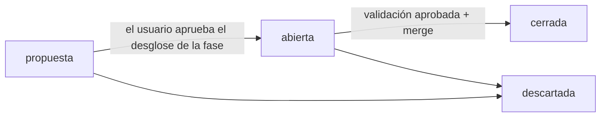

# Sistema de gestión del proyecto

Cómo se organiza el trabajo de ESP-Riego: quién hace qué, cómo se registra y cómo se audita. La decisión que lo origina es [DEC-0001](decisiones/DEC-0001-orquestacion-de-agentes.md).

## Roles

| Rol | Definición | Escribe en |
|---|---|---|
| **coordinador** (sesión principal) | [`CLAUDE.md`](../CLAUDE.md) | `gestion/`, `CLAUDE.md`, `README.md`, `herramientas/`, `.claude/`, `.githooks/`; único que usa git para escribir |
| `ing-esquematicos` | [`.claude/agents/ing-esquematicos.md`](../.claude/agents/ing-esquematicos.md) | `hardware/v2/` (esquema), `docs/diseno/`, `firmware/` |
| `ing-layout` | [`.claude/agents/ing-layout.md`](../.claude/agents/ing-layout.md) | `hardware/v2/` (PCB y reglas), `docs/diseno/` |
| `jr-conformidad` | [`.claude/agents/jr-conformidad.md`](../.claude/agents/jr-conformidad.md) | `hardware/` (librerías, campos, fichas de componentes), `fabricacion/` |
| `ing-validacion` | [`.claude/agents/ing-validacion.md`](../.claude/agents/ing-validacion.md) | `gestion/informes/`, `docs/validacion/` |

Todos los agentes escriben además su log (`gestion/logs/SPEC-NNNN/NN-<agente>.md`) y su memoria (`.claude/agent-memory/<agente>/`). Ninguno usa git para escribir, escribe en la carpeta del TFG ni lanza otros agentes.

## Ciclo de vida de una spec



1. **Proponer.** Al empezar una fase, el coordinador crea sus specs con `estado: propuesta` y el usuario revisa el desglose.
2. **Abrir** en `main`:
   ```bash
   python herramientas/gestion.py nueva-spec --titulo "..." --fase 3 --responsable ing-esquematicos --requisitos ALI-01,ALI-03
   ```
   Commit `spec(SPEC-NNNN): abrir — <título>` y rama `git switch -c spec/SPEC-NNNN-<slug>`.
3. **Encargar.** Orden breve al agente responsable:
   ```
   SPEC-NNNN · rama spec/SPEC-NNNN-<slug> · Lee: <spec + archivos> · Haz: <paso> · Entrega: <archivos> + log NN-<agente>.md
   ```
4. **Integrar.** El coordinador revisa el diff (zonas, log, verificación) y hace commits atómicos con trailers.
5. **Conformidad**, si hay piezas nuevas o campos que revisar.
6. **Validar.** `ing-validacion` entrega `gestion/informes/VAL-NNNN-NN.md` con veredicto `APROBADO`, `APROBADO_CON_OBSERVACIONES` o `RECHAZADO`. Si es `RECHAZADO`, se corrige y se repite (`-02`, `-03`…). Las observaciones se convierten en specs propuestas.
7. **Cerrar.** `estado: cerrada` en la spec, `git merge --no-ff --no-commit`, regenerar tablero y trazabilidad, y commit `merge(SPEC-NNNN): <título>`. Se borra la rama.
8. **Hito.** Al terminar una fase, etiqueta y push solo con OK del usuario.

## Identificadores

| ID | Qué es | Dónde |
|---|---|---|
| `SPEC-NNNN` | Unidad de trabajo atómica | `gestion/specs/SPEC-NNNN-<slug>.md` |
| `VAL-NNNN-NN` | Informe de validación (spec · intento) | `gestion/informes/` |
| `DEC-NNNN` | Decisión de diseño o de proceso (formato ADR) | `gestion/decisiones/` |
| `NN-<agente>` | Log de una intervención dentro de una spec | `gestion/logs/SPEC-NNNN/` |
| `ALI-01` … `FW-04` | Requisitos de la v2 | `docs/02-especificaciones-v2.md` |
| `H1` … `H12` | Hallazgos de la v1 | `docs/01-analisis-v1.md` |

## Commits

```
<tipo>(<ámbito>): <resumen>

<cuerpo opcional>

Spec: SPEC-0007
Agente: ing-esquematicos
Requisitos: ALI-01, ALI-03
Log: gestion/logs/SPEC-0007/01-ing-esquematicos.md
Co-Authored-By: Claude Opus 5.5 <noreply@anthropic.com>
```

- Tipos: `feat`, `fix`, `docs`, `spec`, `val`, `lib`, `fab`, `fw`, `chore`, `merge`, `refactor`, `test`, `revert`.
- En ramas `spec/*` son obligatorios `Spec` (igual al de la rama) y `Agente`.
- Los merges a `main` llevan `Spec`, `Validacion` y `Rama`.
- El hook [`.githooks/commit-msg`](../.githooks/commit_msg.py) lo comprueba. Se activa una vez por clon con `git config core.hooksPath .githooks`.

## Registros

| Qué | Dónde | Quién |
|---|---|---|
| Specs | `specs/` | Coordinador |
| Logs de intervención | `logs/SPEC-NNNN/` | Cada agente |
| Diario de sesión | `logs/coordinador/AAAA-MM-DD.md` | Coordinador |
| Registro automático de acciones | `logs/auditoria/AAAA-MM-DD.jsonl` | Hook `auditoria.py` |
| Informes de validación | `informes/` | `ing-validacion` |
| Decisiones | `decisiones/` | Coordinador (las de diseño, con el usuario) |
| Checklists de revisión | `checklists/` | Las aplica validación; cada cambio sube la versión |
| Plantillas | `plantillas/` | Coordinador |
| Memoria de cada agente | `../.claude/agent-memory/<agente>/MEMORY.md` | Cada agente |
| Tablero | `TABLERO.md` | Generado: `python herramientas/gestion.py tablero` |
| Trazabilidad | `TRAZABILIDAD.md` | Generado: `python herramientas/gestion.py trazabilidad` |

`TABLERO.md` y `TRAZABILIDAD.md` no se editan a mano: se regeneran a partir del front matter de specs e informes y de los trailers de git.

## Guardas

| Hook | Cuándo | Qué hace |
|---|---|---|
| `.claude/hooks/guardia.py` | Antes de `Bash`, `PowerShell`, `Write`, `Edit` de un agente | Bloquea git de escritura, escrituras fuera de la zona del agente y comandos destructivos sobre la carpeta del TFG. Cada bloqueo queda en la auditoría con `ok: false` y el motivo en `bloqueado` |
| `.claude/hooks/auditoria.py` | Después de cada acción relevante de un agente | Añade `{ts, agente, rama, spec, herramienta, objetivo, ok}` al JSONL del día |
| `.githooks/commit-msg` | En cada commit | Formato del asunto y trailers obligatorios |
| `.claude/settings.json` | `git push` | Pide confirmación al usuario |

## Herramientas

| Comando | Para qué |
|---|---|
| `python herramientas/gestion.py nueva-spec ...` | Crea una spec con el siguiente ID libre |
| `python herramientas/gestion.py tablero` | Regenera `TABLERO.md` |
| `python herramientas/gestion.py trazabilidad` | Regenera `TRAZABILIDAD.md` |
| `python herramientas/verificar.py <proyecto>` | ERC, DRC y paridad esquema↔PCB con `kicad-cli` y resumen por tipo |

## Consultas de auditoría

| Consulta | Qué muestra |
|---|---|
| `git log --first-parent main --oneline` | Apertura y cierre de cada spec |
| `git log --all --grep "Spec: SPEC-0007"` | Todo lo hecho en una spec |
| `git log --format="%h %s · %(trailers:key=Agente,valueonly,separator=)"` | Quién hizo cada cambio |
| `git log --grep "Requisitos:.*ALI-03"` | Cambios que afectan a un requisito |
| `gestion/logs/auditoria/*.jsonl` | Cada acción de cada agente, con hora y rama |
