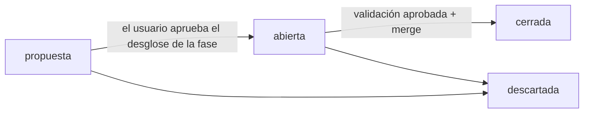

# Sistema de gestión del proyecto

Cómo se organiza el trabajo de ESP-Riego: quién hace qué, cómo se registra y cómo se audita. La decisión que lo origina es [DEC-0001](decisiones/DEC-0001-orquestacion-de-agentes.md).

## Roles

| Rol | Definición | Escribe en |
|---|---|---|
| **coordinador** (sesión principal) | [`CLAUDE.md`](../CLAUDE.md) | `gestion/`, `docs/01`–`docs/03`, `CLAUDE.md`, `README.md`, `herramientas/`, `.claude/`, `.githooks/`; único que usa git para escribir |
| `ing-esquematicos` | [`.claude/agents/ing-esquematicos.md`](../.claude/agents/ing-esquematicos.md) | `hardware/v2/` (esquema), `docs/diseno/`, `firmware/` |
| `ing-layout` | [`.claude/agents/ing-layout.md`](../.claude/agents/ing-layout.md) | `hardware/v2/` (PCB y reglas), `docs/diseno/` |
| `jr-conformidad` | [`.claude/agents/jr-conformidad.md`](../.claude/agents/jr-conformidad.md) | `hardware/` (librerías, campos, fichas de componentes), `fabricacion/` |
| `ing-validacion` | [`.claude/agents/ing-validacion.md`](../.claude/agents/ing-validacion.md) | `gestion/informes/`, `docs/validacion/` |

Todos los agentes escriben además su log (`gestion/logs/SPEC-NNNN/NN-<agente>.md`) y su memoria (`.claude/agent-memory/<agente>/`). Ninguno usa git para escribir, escribe en la carpeta del TFG ni lanza otros agentes.

## Ciclo de vida de una spec



1. **Proponer.** Al empezar una fase, el coordinador crea sus specs con `estado: propuesta` y el usuario revisa el desglose.
2. **Abrir** en `main`:
   ```bash
   python herramientas/gestion.py nueva-spec --titulo "..." --fase 3 --responsable ing-esquematicos --requisitos ALI-01,ALI-03
   ```
   Commit `spec(SPEC-NNNN): abrir — <título>` y rama `git switch -c spec/SPEC-NNNN-<slug>`.
3. **Encargar.** Orden breve al agente responsable:
   ```
   SPEC-NNNN · rama spec/SPEC-NNNN-<slug> · Lee: <spec + archivos> · Haz: <paso> · Entrega: <archivos> + log NN-<agente>.md
   ```
4. **Integrar.** El coordinador revisa el diff (zonas, log, verificación) y hace commits atómicos con trailers.
5. **Conformidad**, si hay piezas nuevas o campos que revisar.
6. **Validar.** `ing-validacion` entrega `gestion/informes/VAL-NNNN-NN.md` con veredicto `APROBADO`, `APROBADO_CON_OBSERVACIONES` o `RECHAZADO`. Si es `RECHAZADO`, se corrige y se repite (`-02`, `-03`…). Las observaciones se convierten en specs propuestas.
7. **Cerrar.** `estado: cerrada` en la spec, `git merge --no-ff --no-commit`, regenerar tablero y trazabilidad, y commit `merge(SPEC-NNNN): <título>`. Se borra la rama.
8. **Hito.** Al terminar una fase, etiqueta y push solo con OK del usuario.

## Identificadores

| ID | Qué es | Dónde |
|---|---|---|
| `SPEC-NNNN` | Unidad de trabajo atómica | `gestion/specs/SPEC-NNNN-<slug>.md` |
| `VAL-NNNN-NN` | Informe de validación (spec · intento) | `gestion/informes/` |
| `DEC-NNNN` | Decisión de diseño o de proceso (formato ADR) | `gestion/decisiones/` |
| `NN-<agente>` | Log de una intervención dentro de una spec | `gestion/logs/SPEC-NNNN/` |
| `ALI-01` … `FW-04` | Requisitos de la v2 | `docs/02-especificaciones-v2.md` |
| `H1` … `H12` | Hallazgos de la v1 | `docs/01-analisis-v1.md` |

## Commits

```
<tipo>(<ámbito>): <resumen>

<cuerpo opcional>

Spec: SPEC-0007
Agente: ing-esquematicos
Requisitos: ALI-01, ALI-03
Log: gestion/logs/SPEC-0007/01-ing-esquematicos.md
Co-Authored-By: Claude Opus 5.5 <noreply@anthropic.com>
```

- Tipos: `feat`, `fix`, `docs`, `spec`, `val`, `lib`, `fab`, `fw`, `chore`, `merge`, `refactor`, `test`, `revert`.
- En ramas `spec/*` son obligatorios `Spec` (igual al de la rama) y `Agente`.
- Los merges a `main` llevan `Spec`, `Validacion` y `Rama`.
- El hook [`.githooks/commit-msg`](../.githooks/commit_msg.py) lo comprueba. Se activa una vez por clon con `git config core.hooksPath .githooks`.

## Registros

| Qué | Dónde | Quién |
|---|---|---|
| Specs | `specs/` | Coordinador |
| Logs de intervención | `logs/SPEC-NNNN/` | Cada agente |
| Diario de sesión | `logs/coordinador/AAAA-MM-DD.md` | Coordinador |
| Registro automático de acciones | `logs/auditoria/AAAA-MM-DD.jsonl` | Hook `auditoria.py` |
| Informes de validación | `informes/` | `ing-validacion` |
| Decisiones | `decisiones/` | Coordinador (las de diseño, con el usuario) |
| Checklists de revisión | `checklists/` | Las aplica validación; cada cambio sube la versión |
| Huella de la carpeta del TFG | `tfg-manifiesto.json` | `herramientas/integridad_tfg.py crear` (solo si el usuario cambia el TFG) |
| Plantillas | `plantillas/` | Coordinador |
| Memoria de cada agente | `../.claude/agent-memory/<agente>/MEMORY.md` | Cada agente |
| Tablero | `TABLERO.md` | Generado: `python herramientas/gestion.py tablero` |
| Trazabilidad | `TRAZABILIDAD.md` | Generado: `python herramientas/gestion.py trazabilidad` |

`TABLERO.md` y `TRAZABILIDAD.md` no se editan a mano: se regeneran a partir del front matter de specs e informes y de los trailers de git.

## Guardas

El control tiene dos capas: **prevención**, que bloquea antes de que ocurra, y **detección**, que encuentra lo que se haya escapado. La guarda es una red de seguridad, no un sandbox: lo que escribe un script de Python o de PowerShell no se puede analizar desde el comando que lo lanza, y por eso existe la segunda capa.

**Prevención**

| Mecanismo | Cuándo | Qué hace |
|---|---|---|
| `disallowedTools` de cada agente | Siempre (lo aplica Claude Code) | Cada agente solo tiene las herramientas MCP de su dominio: `ing-esquematicos` no tiene las de PCB, librerías ni fabricación; `ing-layout`, las de esquema ni librerías; `jr-conformidad`, las de rutado, colocación ni dibujo del esquema. Ninguno controla la interfaz gráfica de KiCad. `ing-validacion` tiene una lista blanca de 72 herramientas de consulta, revisadas por sus parámetros |
| `.claude/hooks/guardia.py` | Antes de `Bash`, `PowerShell`, `Write`, `Edit` y las herramientas MCP de un agente | Bloquea:<br>- git de escritura, también dentro de `bash -c`, `cmd /c`, `pwsh -Command`, `iex`, `xargs` y `$(…)`, con ofuscaciones simples (`g\it`, `$'git'`) y con `-c` o `grep -O` que ejecutan órdenes;<br>- escrituras fuera de la zona del agente, resolviendo las rutas de verdad (relativas, `~`, `/c/…`, nombres cortos 8.3, siguiendo los `cd`), por redirección, con las órdenes de escritura conocidas (`rm`, `mv`, `cp`, `find -delete`, `rsync`, `sed`/`perl`/`awk -i`, `tar`/`7z`/`unzip`, `ln`, `Set-Content`, `Export-Csv`…) y con los scripts del repositorio que escriben (`gestion.py tablero`, `integridad_tfg.py crear`);<br>- **TFG, con lista blanca:** si un comando toca la carpeta del TFG (por ruta, por `cd`, por redirección o en una tubería), cada parte tiene que leer (`ls`, `cat`, `Get-ChildItem`, `md5sum`…) o copiar desde el TFG hacia fuera (`cp`, `Copy-Item`, `robocopy` sin `/MOVE`, `tar -x -C <fuera>`). Cualquier otra orden se bloquea, aunque la guarda no la conozca;<br>- en el MCP, cualquier ruta dentro del TFG, y los destinos (`outputPath`, `schematicPath`, `tablePath`…) de las herramientas de escritura fuera de `hardware/`, `fabricacion/`, `docs/diseno/`, `docs/validacion/` o `firmware/`. Los orígenes de solo lectura, las variables `${…}` y los textos no se consideran destinos;<br>- código en línea (`python -c`) y APIs de .NET que escriben archivos;<br>- en `ing-validacion`, `close_project` sin `save: false` y cualquier herramienta MCP que modifique el diseño.<br>Cada bloqueo queda en la auditoría con `ok: false` y el motivo en `bloqueado` |
| `.githooks/commit-msg` | En cada commit | Formato del asunto y trailers del bloque final (con el mismo criterio que la trazabilidad), IDs de `Requisitos` existentes y rutas de `Log` existentes. En los merges a `main`: `Spec`, `Validacion` y `Rama` de la misma spec, y el TFG intacto según su huella |
| `.claude/settings.json` | `git push` | Pide confirmación al usuario |

**Detección**

| Mecanismo | Cuándo | Qué hace |
|---|---|---|
| `.claude/hooks/auditoria.py` | Después de cada acción de un agente que escribe o ejecuta (`Write`, `Edit`, `Bash`, `PowerShell`, MCP, `WebFetch`, `WebSearch`, `Skill`), tanto si sale bien (`PostToolUse`, en el agente) como si falla (`PostToolUseFailure`, en `settings.json`). Las lecturas (`Read`, `Grep`, `Glob`, `ToolSearch`) no se registran | Añade `{ts, agente, agent_id, rama, spec, herramienta, objetivo, ok}` al JSONL del día, más `error` si falló |
| `herramientas/revisar_zonas.py <agente>` | Antes de cada commit del trabajo de un agente | Lista los archivos cambiados que el agente no podría escribir (detecta lo que haya escrito por el MCP o desde un script) y avisa si a la auditoría versionada se le ha quitado o cambiado alguna línea: la auditoría solo puede crecer |
| `herramientas/integridad_tfg.py verificar` | En cada merge a `main` (lo ejecuta `commit-msg`) | Compara la carpeta del TFG con su huella SHA-256 (`gestion/tfg-manifiesto.json`) |
| Revisión del diff por el coordinador | Antes de cada commit | Última comprobación, que cubre todo lo anterior |

**Límites conocidos**

- Los scripts lanzados por un agente (`python script.py`, `pwsh -File`) pueden escribir sin que la guarda lo vea. `revisar_zonas.py`, la huella del TFG y la revisión del diff los detectan.
- Las variables y la concatenación de la terminal no se expanden: `G=git; $G commit`, `& ('gi'+'t') commit` o `rm -rf $D` pasan. Son los casos N24, N31 y N33 de `herramientas/pruebas/test_guardia.py`, marcados como límites. Fuera de la carpeta del TFG, cualquier orden de escritura que la guarda no conozca también pasa. En ambos casos actúa la capa de detección.
- Las herramientas MCP que trabajan sobre la placa o el esquema cargados no llevan ruta, así que la guarda no puede comprobar su zona. Las controlan `disallowedTools` y `revisar_zonas.py`. De las herramientas de escritura con ruta, solo se comprueban los argumentos de destino conocidos (`CLAVES_DESTINO` en `guardia.py`).
- La guarda trata como orden de git cualquier `git <palabra>` que aparezca en un comando, incluso dentro de un texto. Para buscar texto se usa la herramienta Grep.
- **Copia de seguridad del TFG:** la huella detecta cualquier cambio, pero no lo repara. El usuario mantiene su propia copia del TFG fuera del sistema (lo confirmó el 2026-11-03).

## Herramientas

| Comando | Para qué |
|---|---|
| `python herramientas/gestion.py nueva-spec ...` | Crea una spec con el siguiente ID libre |
| `python herramientas/gestion.py tablero` | Regenera `TABLERO.md` |
| `python herramientas/gestion.py trazabilidad` | Regenera `TRAZABILIDAD.md` |
| `python herramientas/verificar.py <proyecto>` | ERC, DRC y paridad esquema↔PCB con `kicad-cli` y resumen por tipo. Deja el proyecto como estaba y se niega a verificar la carpeta del TFG |
| `python herramientas/revisar_zonas.py <agente>` | Archivos cambiados fuera de la zona del agente |
| `python herramientas/integridad_tfg.py verificar` | Compara la carpeta del TFG con su huella (`crear` la regenera) |
| `python herramientas/pruebas/test_guardia.py` | Batería de regresión de la guarda |
| `python herramientas/pruebas/test_commit_msg.py` | Batería de regresión del hook `commit-msg` |

## Consultas de auditoría

| Consulta | Qué muestra |
|---|---|
| `git log --first-parent main --oneline` | Apertura y cierre de cada spec |
| `git log --all --grep "Spec: SPEC-0007"` | Todo lo hecho en una spec |
| `git log --format="%h %s · %(trailers:key=Agente,valueonly,separator=)"` | Quién hizo cada cambio |
| `git log --grep "Requisitos:.*ALI-03"` | Cambios que afectan a un requisito |
| `gestion/logs/auditoria/*.jsonl` | Cada acción de cada agente, con hora y rama |
