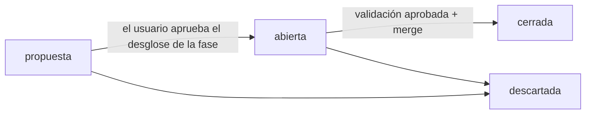

# Sistema de gestión del proyecto

Cómo se organiza el trabajo de ESP-Riego: quién hace qué, cómo se registra y cómo se audita. Las decisiones que lo originan son [DEC-0001](decisiones/DEC-0001-orquestacion-de-agentes.md), [DEC-0005](decisiones/DEC-0005-ahorro-de-tokens.md) y [DEC-0009](decisiones/DEC-0009-orquestacion-v2.md).

## Roles

| Rol | Definición | Modelo | Escribe en |
|---|---|---|---|
| **coordinador** (sesión principal) | [`CLAUDE.md`](../CLAUDE.md) | el de la sesión | `gestion/`, `docs/01`–`docs/03`, `CLAUDE.md`, `README.md`, `herramientas/`, `.claude/`, `.githooks/`; único que usa git para escribir |
| `ing-diseno` | [`.claude/agents/ing-diseno.md`](../.claude/agents/ing-diseno.md) | el de la sesión | `hardware/` (salvo `v1-tfg/`), `docs/diseno/`, `firmware/`, `herramientas/kicad/` |
| `jr-conformidad` | [`.claude/agents/jr-conformidad.md`](../.claude/agents/jr-conformidad.md) | Sonnet | `hardware/` (fichas, tablas de campos, campos de los esquemas), `fabricacion/` |
| `ing-validacion` | [`.claude/agents/ing-validacion.md`](../.claude/agents/ing-validacion.md) | el de la sesión; Sonnet en el nivel ligero | `gestion/informes/`, `docs/validacion/` |

`ing-diseno` lleva cada bloque de principio a fin: cálculos, piezas, esquema y PCB. Lo que se mantiene separado es la revisión: quien diseña no valida. `ing-diseno` y `jr-conformidad` escriben además su parte (`gestion/logs/SPEC-NNNN/NN-<agente>.md`; validación no: su registro es el informe), y todos, su memoria (`.claude/agent-memory/<agente>/`). Ninguno usa git para escribir, escribe en la carpeta del TFG ni lanza otros agentes.

## Ciclo de vida de una spec



Una spec cubre un **bloque** (selección y cálculos, piezas, hoja y sincronización de la PCB) o un **hito de layout** (reglas y *floorplan*, colocación, rutado de potencia, resto y acabado). Sus pasos van dentro de la spec.

1. **Proponer.** Al empezar una fase, el coordinador crea sus specs con `estado: propuesta` y el usuario revisa el desglose.
   ```bash
   python herramientas/gestion.py nueva-spec --titulo "..." --fase 3 --responsable ing-diseno --requisitos ALI-01,ALI-03 --estado propuesta
   ```
2. **Abrir.** El coordinador completa la spec: objetivo, entradas con las secciones que hay que leer, criterios verificables y plan de validación. Sin pasos de detalle ni números de línea, y sin repetir lo que ya ha comprobado. La repasa con su checklist y busca contradicciones entre «Incluye», «Excluye» y los criterios (DEC-0005). Después:
   ```bash
   python herramientas/gestion.py abrir SPEC-NNNN
   ```
   que pone el estado, anota el registro, regenera el tablero, hace el commit `spec(SPEC-NNNN): abrir — <título>` en `main` y crea la rama.
3. **Encargar** cada paso con una orden breve: `SPEC-NNNN · rama <rama> · paso <n> · Entrega: <archivos> + parte NN`. La spec tiene que bastar, porque el agente no ve la conversación del coordinador. Un solo agente escribe en `hardware/v2` a la vez, y antes de encargar un paso que escriba en KiCad se comprueba que KiCad no tiene abierto el proyecto (archivos `.lck`). Las validaciones y las consultas que trabajan sobre copias pueden ir en paralelo si no cargan un proyecto en el MCP.
4. **Integrar.** Al volver el agente:
   ```bash
   python herramientas/gestion.py revisar <agente>
   python herramientas/gestion.py integrar SPEC-NNNN --agente <agente> --tipo feat --resumen "..." --tokens <N> --agent-id <id>
   ```
   `revisar` resume en 25 líneas los archivos cambiados, los que quedan fuera de la zona del agente, el parte, los bloqueos y fallos nuevos de la auditoría y, si cambió KiCad, los recuentos de `verificar.py`. `integrar` hace el commit con sus trailers y anota en el registro de la spec lo que ha costado el arranque: los tokens los da el resultado del agente; las acciones y los minutos salen de la auditoría.
5. **Entre pasos, comprobaciones automáticas** (`verificar.py` y las herramientas de `herramientas/kicad/`). `jr-conformidad` entra al final del bloque para el tipo y el stock, la tabla de campos y las fichas.
6. **Validar** una vez, al final de la spec. `ing-validacion` entrega `gestion/informes/VAL-NNNN-NN.md` con veredicto `APROBADO`, `APROBADO_CON_OBSERVACIONES` o `RECHAZADO`.
   - El **plan de validación** de la spec dice el nivel y dónde está el riesgo: qué se reproduce de forma independiente (cotas, mapeo de pines, cálculos con poco margen, lo que va a cobre) y qué se comprueba por muestreo (stock, campos, enlaces).
   - **Nivel** (DEC-0005): `ligero`, para texto, documentación y proceso; `completo`, para piezas, esquema, layout y fabricación. Ante la duda, completo. La definición de `ing-validacion` usa el modelo de la sesión: en el nivel ligero, el coordinador lo lanza con `model: sonnet`.
   - En el layout hay validación completa en el primer hito (reglas y *floorplan*) y en el último; en los intermedios bastan las comprobaciones automáticas y el visto bueno del usuario sobre una imagen.
7. **Corregir y revalidar** continuando la misma instancia del agente (`SendMessage`), que ya tiene el contexto. Una instancia nueva, solo para un paso nuevo. La revalidación se limita a los hallazgos y a lo corregido, y genera el informe siguiente (`-02`).
   - Las M que afectan a la spec siguiente se corrigen antes del merge. Las B y las M que no bloquean se apuntan, una línea cada una, en la spec de mantenimiento de la fase, que está en `propuesta` desde que aparece la primera.
8. **Cerrar.** El coordinador reescribe [`ESTADO.md`](ESTADO.md) y ejecuta:
   ```bash
   python herramientas/gestion.py cerrar SPEC-NNNN
   ```
   que comprueba el veredicto, cierra la spec, hace `git merge --no-ff` a `main`, regenera tablero y trazabilidad, hace el commit `merge(SPEC-NNNN): <título>` y borra la rama. Después, `git push origin main`, que está autorizado tras cada merge, y se recuerda al usuario que abra sesión nueva o compacte (DEC-0005).
9. **Hito.** Al terminar una fase se abre su spec de mantenimiento si tiene observaciones; la etiqueta, con OK del usuario.

Las ediciones del coordinador en su zona (checklists, decisiones, specs, plantillas y este manual) se hacen sin agente y sin validación propia, salvo que cambien `docs/02` o los hooks (DEC-0005). Si un cambio toca hooks o scripts: `python -m py_compile` y las baterías de `herramientas/pruebas/`.

## Identificadores

| ID | Qué es | Dónde |
|---|---|---|
| `SPEC-NNNN` | Unidad de trabajo: un bloque, un hito de layout o un cambio de proceso | `gestion/specs/SPEC-NNNN-<slug>.md` |
| `VAL-NNNN-NN` | Informe de validación (spec · intento) | `gestion/informes/` |
| `DEC-NNNN` | Decisión de diseño o de proceso (formato ADR) | `gestion/decisiones/` |
| `NN-<agente>` | Parte de una intervención dentro de una spec | `gestion/logs/SPEC-NNNN/` |
| `ALI-01` … `FW-04` | Requisitos de la v2 | `docs/02-especificaciones-v2.md` |
| `H1` … `H12` | Hallazgos de la v1 | `docs/01-analisis-v1.md` |

## Commits

```
<tipo>(<ámbito>): <resumen>

<cuerpo opcional>

Spec: SPEC-0007
Agente: ing-diseno
Requisitos: ALI-01, ALI-03
Log: gestion/logs/SPEC-0007/01-ing-diseno.md
Co-Authored-By: <modelo> <noreply@anthropic.com>
```

- Tipos: `feat`, `fix`, `docs`, `spec`, `val`, `lib`, `fab`, `fw`, `chore`, `merge`, `refactor`, `test`, `revert`.
- En ramas `spec/*` son obligatorios `Spec` (igual al de la rama) y `Agente`.
- Los merges a `main` llevan `Spec`, `Validacion` y `Rama`.
- `gestion.py abrir`, `integrar` y `cerrar` escriben estos mensajes. El hook [`.githooks/commit-msg`](../.githooks/commit_msg.py) los comprueba; se activa una vez por clon con `git config core.hooksPath .githooks`.

## Registros

Cada hecho se escribe una vez: el **parte** dice qué se hizo y por qué, el **informe** dice qué se encontró y el **commit** dice qué cambió. El registro de la spec y el tablero se generan.

| Qué | Dónde | Quién |
|---|---|---|
| Qué toca ahora | [`ESTADO.md`](ESTADO.md): siguiente paso, pendientes del usuario y notas para layout y fabricación; 50 líneas como máximo | Coordinador, en cada cierre |
| Specs | `specs/`; su sección «Registro» lleva una fila por intervención, con tokens, acciones y minutos | Coordinador y `gestion.py` |
| Partes | `logs/SPEC-NNNN/`: decisiones no obvias, desviaciones y pendientes, en 40 líneas como máximo. Los datos van en su archivo (por ejemplo, `hardware/componentes/campos-<bloque>.csv`) | Agentes de diseño |
| Informes de validación | `informes/`; son también el registro de la intervención de validación | `ing-validacion` |
| Registro automático de acciones | `logs/auditoria/AAAA-MM-DD.jsonl` | Hook `auditoria.py`; se lee con `gestion.py revisar` |
| Decisiones | `decisiones/` | Coordinador (las de diseño, con el usuario) |
| Checklists | `checklists/`; cada punto es `[auto]` (lo comprueba un script) o `[juicio]`; cada cambio sube la versión | Las aplican el autor y validación |
| Huella de la carpeta del TFG | `tfg-manifiesto.json` | `herramientas/integridad_tfg.py crear` (solo si el usuario cambia el TFG) |
| Plantillas | `plantillas/` | Coordinador |
| Memoria de cada agente | `../.claude/agent-memory/<agente>/MEMORY.md` | Cada agente |
| Tablero, con el coste por spec y por agente | `TABLERO.md` | Generado: `gestion.py tablero` |
| Trazabilidad | `TRAZABILIDAD.md` | Generado: `gestion.py trazabilidad` |
| Diario del coordinador hasta el 2026-11-11 | `logs/coordinador/` | Histórico: lo sustituye `ESTADO.md` |

`TABLERO.md` y `TRAZABILIDAD.md` no se editan a mano: se regeneran a partir del front matter y del registro de las specs, de los informes y de los trailers de git.

## Guardas

El control tiene dos capas: **prevención**, que bloquea antes de que ocurra, y **detección**, que encuentra lo que se haya escapado. La guarda es una red de seguridad contra accidentes, no un sandbox: lo que escribe un script o el código en línea de Python no se analiza, y por eso existe la segunda capa. Desde DEC-0009 no se endurece más.

**Prevención**

| Mecanismo | Cuándo | Qué hace |
|---|---|---|
| Herramientas de cada agente | Siempre (lo aplica Claude Code) | `ing-diseno` tiene todo el MCP salvo el control de la interfaz gráfica de KiCad. `jr-conformidad` e `ing-validacion` tienen listas blancas: compra, campos, consulta y exportación el primero; 72 herramientas de consulta, revisadas por sus parámetros, el segundo |
| `.claude/hooks/guardia.py` | Antes de `Bash`, `PowerShell`, `Write`, `Edit` y las herramientas MCP de un agente | Bloquea:<br>- git de escritura, también dentro de `bash -c`, `cmd /c`, `pwsh -Command`, `iex`, `xargs` y `$(…)`, con ofuscaciones simples (`g\it`, `$'git'`) y con `-c` o `grep -O` que ejecutan órdenes;<br>- escrituras fuera de la zona del agente, resolviendo las rutas de verdad (relativas, `~`, `/c/…`, nombres cortos 8.3, siguiendo los `cd` y sustituyendo las variables que se asignan en el propio comando), por redirección, con las órdenes de escritura conocidas (`rm`, `mv`, `cp`, `find -delete`, `rsync`, `sed`/`perl`/`awk -i`, `tar`/`7z`/`unzip`, `ln`, `Set-Content`, `Export-Csv`…) y con los scripts del repositorio que escriben (`gestion.py tablero`, `integridad_tfg.py crear`);<br>- **TFG, con lista blanca:** si un comando toca la carpeta del TFG (por ruta, por `cd`, por redirección, en una tubería o dentro de un heredoc), cada parte tiene que leer (`ls`, `cat`, `Get-ChildItem`, `md5sum`…) o copiar desde el TFG hacia fuera. Cualquier otra orden se bloquea, aunque la guarda no la conozca;<br>- en el MCP, cualquier ruta dentro del TFG, y los destinos (`outputPath`, `schematicPath`, `tablePath`…) de las herramientas de escritura fuera de `hardware/`, `fabricacion/`, `docs/diseno/`, `docs/validacion/` o `firmware/`;<br>- APIs de .NET que escriben archivos;<br>- en `ing-validacion`, `close_project` sin `save: false` y cualquier herramienta MCP que modifique el diseño.<br>La carpeta temporal siempre se puede escribir. Cada bloqueo queda en la auditoría con `ok: false` y el motivo en `bloqueado` |
| `.githooks/commit-msg` | En cada commit | Formato del asunto y trailers del bloque final, IDs de `Requisitos` existentes y rutas de `Log` existentes. En los merges a `main`: `Spec`, `Validacion` y `Rama` de la misma spec, y el TFG intacto según su huella |
| `.claude/settings.json` | `git push` | Pide confirmación al usuario |

**Detección**

| Mecanismo | Cuándo | Qué hace |
|---|---|---|
| `.claude/hooks/auditoria.py` | Después de cada acción de un agente que escribe o ejecuta (`Write`, `Edit`, `Bash`, `PowerShell`, MCP, `WebFetch`, `WebSearch`, `Skill`), tanto si sale bien como si falla. Las lecturas no se registran | Añade `{ts, agente, agent_id, rama, spec, herramienta, objetivo, ok}` al JSONL del día, con `objetivo` cortado a 160 caracteres, más `error` si falló |
| `gestion.py revisar <agente>` e `integrar` | Antes de cada commit del trabajo de un agente | Listan los archivos cambiados que el agente no podría escribir, que es como se detecta lo que haya escrito por el MCP o desde un script. El tablero, la trazabilidad, `ESTADO.md` y las filas de registro de la spec son del coordinador y no cuentan; cualquier otro cambio en la spec, sí. `herramientas/revisar_zonas.py <agente>` hace la misma comprobación suelta y avisa si a la auditoría versionada se le ha quitado alguna línea |
| `herramientas/integridad_tfg.py verificar` | En cada merge a `main` (lo ejecuta `commit-msg`) | Compara la carpeta del TFG con su huella SHA-256 (`gestion/tfg-manifiesto.json`) |

**Límites conocidos**

- Los scripts que lanza un agente y el código en línea de `python` o `node` (`-c`, heredoc) pueden escribir sin que la guarda lo vea, salvo que el comando mencione el TFG. La detección los cubre.
- El cuerpo de un heredoc (`<<EOF`) solo se deja sin analizar si lo reciben `cat`, `tee` o un intérprete y la línea no lo pasa a una shell (`| bash`, `source`); con el delimitador sin comillas se analizan las líneas que llevan `$(…)` o comillas invertidas, que la shell ejecuta. Las variables se sustituyen en orden, y una asignación tras `&&` solo vale hasta que acaba su cadena.
- La concatenación no se analiza: `& ('gi'+'t') commit` pasa (caso N33 de la batería). Tampoco se analizan `case … esac` (K07) ni una *here-string* hacia una shell, `bash <<< '…'` (HD12). Las variables que no se asignan en el propio comando no se sustituyen. Fuera de la carpeta del TFG, una orden de escritura que la guarda no conozca también pasa (`uniq a b`, `tree -o`). La batería falla si un caso de `LIMITES` no está citado aquí.
- Ofuscaciones deliberadas que pasan (VAL-0026-02-01): una shell invocada de forma rara detrás de un heredoc (`| env -i bash`, `| busybox sh`, `| $SHELL`, `>(bash)`, `eval "$(cat <<…)"`), una asignación tras `||` seguida de `&&` y las comillas `$'…'`. Y falsos positivos (VAL-0026-02-02): en un heredoc sin comillas, una línea con comillas invertidas y `>`; y el cuerpo de un heredoc para un programa que no sea `cat`, `tee` o un intérprete, que se analiza como órdenes. Los textos largos se escriben con `Write`.
- Las herramientas MCP que trabajan sobre la placa o el esquema cargados no llevan ruta, así que su zona no se comprueba al llamarlas. De las que llevan ruta, solo se comprueban los argumentos de destino conocidos (`CLAVES_DESTINO` en `guardia.py`).
- La guarda trata como orden de git cualquier `git <palabra>` que aparezca en un comando, incluso dentro de un texto. Para buscar texto se usa la herramienta Grep.
- **Copia de seguridad del TFG:** la huella detecta cualquier cambio, pero no lo repara. El usuario mantiene su propia copia del TFG fuera del sistema (lo confirmó el 2026-11-03).

## Herramientas

| Comando | Para qué |
|---|---|
| `python herramientas/gestion.py nueva-spec ...` | Crea una spec con el siguiente ID libre |
| `python herramientas/gestion.py abrir SPEC-NNNN` | Abre la spec: commit en `main` y rama |
| `python herramientas/gestion.py revisar <agente>` | Resumen de lo que hay que mirar antes de integrar |
| `python herramientas/gestion.py integrar SPEC-NNNN ...` | Commit del trabajo de un agente, con trailers y coste |
| `python herramientas/gestion.py registrar SPEC-NNNN ...` | Fila suelta en el registro de la spec |
| `python herramientas/gestion.py cerrar SPEC-NNNN` | Cierra la spec validada: merge a `main` y rama borrada |
| `python herramientas/gestion.py tablero` / `trazabilidad` | Regeneran `TABLERO.md` y `TRAZABILIDAD.md` |
| `python herramientas/verificar.py <proyecto>` | ERC, DRC y paridad esquema↔PCB con `kicad-cli`. Deja el proyecto como estaba y se niega a verificar la carpeta del TFG |
| `herramientas/kicad/` | Herramientas de diseño versionadas (SPEC-0027): su README dice lo que hay |
| `python herramientas/revisar_zonas.py <agente>` | Archivos cambiados fuera de la zona del agente |
| `python herramientas/integridad_tfg.py verificar` | Compara la carpeta del TFG con su huella (`crear` la regenera) |
| `python herramientas/pruebas/test_guardia.py` | Batería de la guarda |
| `python herramientas/pruebas/test_commit_msg.py` | Batería del hook `commit-msg` |
| `python herramientas/pruebas/test_gestion.py` | Batería del ciclo de `gestion.py`, en un repositorio temporal |

## Consultas de auditoría

| Consulta | Qué muestra |
|---|---|
| `git log --first-parent main --oneline` | Apertura y cierre de cada spec |
| `git log --all --grep "Spec: SPEC-0007"` | Todo lo hecho en una spec |
| `git log --format="%h %s · %(trailers:key=Agente,valueonly,separator=)"` | Quién hizo cada cambio |
| `git log --grep "Requisitos:.*ALI-03"` | Cambios que afectan a un requisito |
| `gestion/TABLERO.md`, secciones de coste | Tokens, acciones y minutos por spec y por agente |
| `gestion/logs/auditoria/*.jsonl` | Cada acción de cada agente, con hora y rama |
