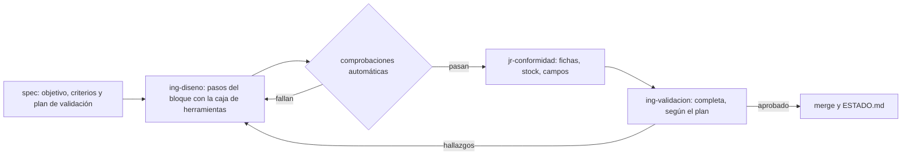

# DEC-0009 · Orquestación v2: menos traspasos, menos papel y herramientas versionadas

## Contexto

El usuario pide revisar la orquestación de DEC-0001 con tres objetivos: que el sistema esté orientado a **diseñar la PCB** (quedan la hoja de salidas, dos bloques, todo el layout y la fabricación), que los agentes no carguen con instrucciones ni ficheros de salida de más, y que gaste menos tokens. Revisión hecha el 2026-11-11 sobre el repositorio y la auditoría del 3 al 10 de noviembre.

### Lo que se ha medido

| Dato | Valor |
|---|---|
| Specs creadas | 26 (20 cerradas, 3 descartadas, 3 propuestas) |
| Informes de validación | 29, de ellos 8 `RECHAZADO` y 10 revalidaciones |
| Arranques de agente | 68 |
| Acciones auditadas | 2 917: Bash 65 %, Write y Edit 22 %, web 8 %, **MCP de KiCad 4 % (114)** |
| Acciones por agente | validación 40 %, esquemáticos 34 %, conformidad 22 %, layout 4 % |
| Acciones en la carpeta temporal | 1 234 (42 %) |
| Scripts desechables escritos por los agentes | 277 archivos `.py`, 874 KB, aún en `%TEMP%\claude`. Se repiten: `gen.py`, `sync.py`, `jlc.py`, `render.py`, `lcsc.py`, `pins.py`, `mk_pcb.py`, `cruce.py` |
| Consultas a LCSC y JLCPCB por `curl` | ≈ 114 |
| Acciones fallidas · bloqueos de la guarda | 140 · 88 |
| Texto de proceso versionado | auditoría 1 208 KB · informes 447 KB · logs de agentes 367 KB · specs 112 KB · diario 38 KB |
| Instrucciones fijas por arranque | cuerpo de la definición ≈ 1 500 tokens; `CLAUDE.md` ≈ 2 000, la mitad solo para el coordinador |
| Documentos de diseño por bloque | 47–94 KB cada uno (15 000–30 000 tokens), leídos enteros por cada agente que toca el bloque |

No hay medida de tokens por arranque: la única cifra es la estimación de DEC-0005 (65 000–280 000).

### Diagnóstico

1. **Las instrucciones de los agentes no son largas; son de trámite.** 1 500 tokens por arranque no pesan frente a los 65 000–280 000 del trabajo. Lo que cuesta es lo que obligan a escribir (orden copiada literal, contexto consultado, checklist recitada punto por punto) y lo que no dicen: ninguna definición explica un método de diseño. La de layout es una lista de identificadores de requisitos. Protocolo, brevedad, contrato y prohibiciones están copiados en las cuatro.
2. **La herramienta real no es el MCP, son scripts que se tiran.** Según las memorias de los agentes, `sync_schematic_to_board` no sirve para dejar la paridad a cero, las llamadas por lotes se cortan a los 30 s y la hoja del MCU se generó entera con un script propio (ERC 0 al primer intento). La partición de herramientas (≈ 100 líneas de `disallowedTools` en tres definiciones), la guarda de destinos del MCP y la exclusión mutua de KiCad protegen el 4 % de las acciones. Los scripts que hacen el trabajo no están versionados ni revisados y cada agente los reescribe.
3. **Los traspasos entre agentes van en prosa.** Como las zonas son rígidas, `jr-conformidad` deja en su log la tabla de campos de 87 referencias y los cambios a `salidas.md` «con el texto exacto», validación revisa hasta la forma de esas propuestas (VAL-0024-01-03 y -06) y otro agente las transcribe en la spec siguiente. Cada bloque son tres specs (cálculos, piezas, hoja) con tres validaciones completas. Los rechazos de diseño salieron de esas costuras: vías de 0,2/0,5 mm en huellas `ThermalVias` (dos veces) y la sincronización de la PCB (VAL-0018-01, VAL-0019-01).
4. **El mismo hecho se escribe hasta seis veces:** contrato de salida, log, registro de la spec, diario, mensaje de commit e informe. Validación escribe además un log que resume su propio informe. SPEC-0024 dejó unos 60 KB de texto de proceso para una huella editada y seis fichas.
5. **Validación es el mayor consumidor y siempre arranca en frío.** Escribió 96 de los scripts desechables, recomprueba cosas de riesgo bajo (el stock de 20 códigos, con deriva menor del 0,1 %) y cada revalidación es una instancia nueva que relee todo. Lo mismo pasa con las correcciones del autor: al menos 20 de los 68 arranques rehicieron un contexto que otra instancia ya tenía. Su trabajo vale lo que cuesta cuando apunta al riesgo (pasta del EP, tapado de vías, polaridad del LED).
6. **La guarda cuesta más en falsos positivos que en lo que evita.** Los agentes no son adversarios; el riesgo real es el accidente. Hoy hay tres notas de memoria dedicadas a esquivarla y el diario anota falsos positivos en casi cada spec.
7. **Los agentes están fijados a `opus`:** no usan el modelo de la sesión.

## Opciones consideradas

| Opción | Qué es | A favor | En contra |
|---|---|---|---|
| A · Ajuste fino | Mismos cuatro agentes y zonas; solo M1, M4, M5, M6 y M8 | Riesgo mínimo; se hace en una spec | Mantiene los traspasos en prosa y las tres validaciones por bloque. En el layout, cada intercambio de pines o retoque de huella sería una vuelta completa entre agentes |
| **B · Rediseño (recomendada)** | Las diez medidas de abajo | Ataca las tres causas de fondo: traspasos, herramientas desechables y papel | Dos specs de trabajo antes de seguir con el diseño. Se pierde la separación de herramientas entre esquema y layout |
| C · Sin subagentes de diseño | El coordinador diseña y solo valida un agente | Cero traspasos | El contexto de la sesión principal se llena en una spec; se pierde el aislamiento que hoy sí funciona |

## Decisión

**El usuario acepta la opción B completa (M1 a M10) el 2026-11-11.** El coordinador la recomendaba; el mínimo con efecto era M1 + M4 + M5 + M6. M5 se aplica entera, sin conservar el relato por intervención.

| # | Medida | Ataca | Efecto esperado |
|---|---|---|---|
| M1 | **Caja de herramientas versionada** en `herramientas/kicad/`, recuperada de los scripts que ya funcionaron: consulta de tipo y stock de N códigos, generador de hojas, aplicación de campos desde una tabla, sincronización netlist → PCB, colocación desde una tabla, imagen de hoja, placa, zona o huella, cotas y pasta de una huella, y comprobación de restricciones por red. Salida corta. La usan igual autores y validación | 2, 5 | El mayor. Desaparece casi toda la escritura y depuración de scripts (874 KB hasta hoy) y cada operación pasa de varias acciones a una |
| M2 | **Tres agentes en vez de cuatro.** `ing-diseno` = esquema + layout + piezas (símbolos, huellas, 3D), con zona `hardware/` (salvo `v1-tfg`), `docs/diseno/` y `firmware/`. `jr-conformidad` se queda en lo mecánico: tipo y stock, fichas, tablas de campos, BOM, CPL y paquete de fabricación. `ing-validacion` no cambia de papel. Se conserva lo que da valor: quien diseña no valida | 2, 3 | Sin vueltas entre agentes por un intercambio de pines o una huella. Una memoria común en vez de dos. Desaparecen las listas de `disallowedTools` salvo la de la interfaz gráfica |
| M3 | **Una spec por bloque o por hito de layout,** con pasos internos y una sola validación completa al final. Entre pasos, comprobaciones automáticas. Layout: L1 reglas, contorno y *floorplan* → L2 colocación → L3 potencia y salidas → L4 resto, zonas, serigrafía y 3D; validación completa en L1 y L4, y una imagen para el visto bueno del usuario en L1 y L2 | 3, 5 | De tres ciclos de spec y tres validaciones completas por bloque a uno |
| M4 | **Continuar la misma instancia** (`SendMessage`) para las correcciones del autor y las revalidaciones, en vez de arrancar otra | 5 | La revalidación deja de releer spec, documentos y datasheets |
| M5 | **Menos papel.** El log pasa a ser un *parte* de 40 líneas como máximo: decisiones no obvias, desviaciones y pendientes; de la checklist, solo lo que no cumple o no aplica. Los datos (campos, stock) van a archivos de datos en su sitio, no al log. Validación no escribe log: su registro es el informe. El diario se sustituye por un único `gestion/ESTADO.md` de unas 50 líneas que se reescribe en cada merge. Las observaciones de mantenimiento se apuntan en la spec de mantenimiento de la fase | 4 | De seis registros del mismo hecho a tres: parte, informe y commit |
| M6 | **Trámite del coordinador en `gestion.py`:** `abrir`, `revisar <agente>` (zonas, parte, resumen de bloqueos y fallos de la auditoría y `verificar.py` si cambió KiCad, en 25 líneas), `integrar` y `cerrar`. **Libro de tokens:** tokens, acciones y duración de cada arranque en el registro de la spec, sumados en el tablero | 4 y la falta de medida | De 10–15 acciones del coordinador por spec a 4. Por primera vez se sabe qué cuesta cada spec |
| M7 | **Instrucciones.** Lo común (protocolo, contrato, prohibiciones) pasa a `CLAUDE.md` una sola vez y la parte del coordinador se reduce a un puntero al manual. Las definiciones ganan el **método**: plan, herramienta, comprobación, imagen, y cuándo parar a preguntar. Las specs dan objetivo, restricciones, criterios y un **plan de validación** (qué se reproduce de forma independiente y qué se muestrea), sin pasos ni números de línea. En las checklists, cada punto se marca `[auto]` (lo comprueba un script y nadie lo repasa) o `[juicio]` | 1, 5 | Specs de 60 líneas en vez de 90. Validación gasta donde hay riesgo |
| M8 | **Modelos** (sustituida por DEC-0010: Opus). `ing-diseno` y la validación completa, con el modelo de la sesión (`model: inherit`); `jr-conformidad` y la validación ligera, en Sonnet | 7 | El diseño usa el modelo más capaz. Su coste por spec se comprueba con el libro de tokens en la primera spec |
| M9 | **Guarda congelada.** No se endurece más: SPEC-0002 se descarta. Dos relajaciones: la carpeta temporal siempre se puede escribir, aunque la ruta vaya en una variable, y el código en línea que no toca el TFG pasa. Se mantienen el TFG de solo lectura, git solo para el coordinador y `revisar_zonas.py` sobre el diff, que es la comprobación real | 6 | Menos reintentos y menos notas de memoria para esquivarla |
| M10 | **Preparar el layout.** Una tabla única de restricciones por red, sacada de los documentos de bloque, que se traduce a clases de red y `.kicad_dru` para que el DRC la compruebe solo. Antes de la fase 4, una prueba corta sobre una copia para elegir herramienta de colocación y rutado: MCP, script de `pcbnew` o Freerouting | 2 | El agente de layout lee una tabla en vez de 150 KB de documentos, y se sabe qué herramienta funciona antes de empezar |

### Ciclo propuesto

Las flechas de vuelta continúan la instancia que ya tiene el contexto.

### Desglose propuesto

1. **SPEC-0026 · Orquestación v2** (M2 a M9; responsable, el coordinador).
2. **SPEC-0027 · Caja de herramientas de KiCad** (M1 y la comprobación de restricciones de M10; responsable `ing-diseno`, validación completa). Se crea al cerrar la 0026.
3. **SPEC-0025 · Hoja de salidas**, como piloto: mismo tipo de trabajo que SPEC-0022 (5 arranques y 210 acciones para 21 piezas), que sirve de referencia.
4. La tabla de restricciones y la prueba de herramientas de M10 entran en el desglose de la fase 4.

## Consecuencias

- DEC-0001 queda sustituida en la tabla de agentes y en la regla 6 (con escrituras por script sobre archivos y `kicad-cli` sobre copias, la exclusión mutua solo afecta a quien haga `open_project`). DEC-0005 sigue vigente y se amplía.
- Cambian `CLAUDE.md`, `gestion/README.md`, las definiciones de `.claude/agents/`, las plantillas, `gestion.py`, `auditoria.py`, `guardia.py` y las memorias de esquemáticos y layout, que se funden.
- Los logs, informes y diarios anteriores se conservan como están.

Compromisos que se aceptan:

- **Separación de funciones:** esquema y layout dejan de estar separados por herramientas. Esa separación no revisaba nada; la revisión independiente se mantiene.
- **Errores de cálculo detectados más tarde:** con una validación por bloque, un cálculo erróneo se vería con la hoja ya dibujada. Lo compensan las comprobaciones automáticas entre pasos y el historial: ninguna spec de cálculos se rechazó.
- **Menos relato:** quedan git, los informes, las decisiones y los partes. Si el relato de cada intervención hace falta para una memoria escrita, M5 se puede aplicar solo a validación y al diario.
- **Instancias continuadas:** el contexto crece. Regla: se continúa para corregir o revalidar la misma entrega; un paso nuevo arranca una instancia nueva.
- **Coste de entrada:** dos specs sin avanzar el diseño. Se recupera si el piloto baja de forma clara las acciones por pieza frente a SPEC-0022.

Qué revisar más adelante: si `jr-conformidad` sigue haciendo falta cuando la consulta de stock y el paquete de fabricación sean una orden; si alguna clase de validación completa puede bajar a Sonnet; y si la guarda puede reducirse a tres reglas cuando todo el trabajo pase por la caja de herramientas.
